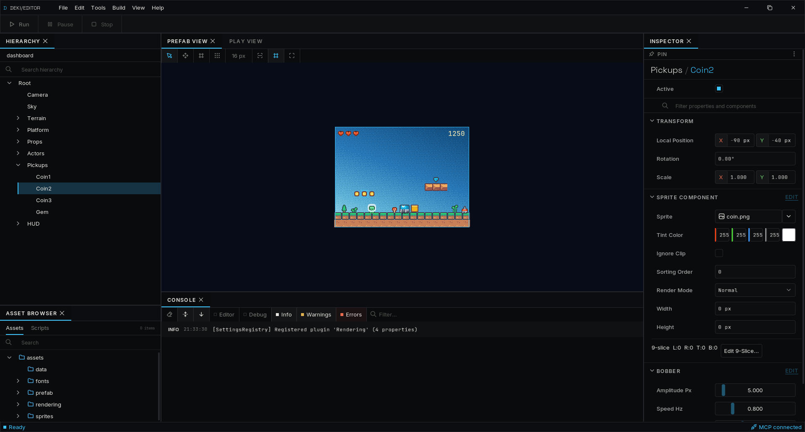

# Deki Editor

A scene editor for [Deki](https://github.com/dekiengine/deki-engine), a modular
C++ 2D engine for small displays: drive an LCD from an ESP32-S3, run the same
project on the desktop through SDL3, or use the engine headless. The editor is
Unity-shaped (hierarchy, inspector, scene view, asset browser, console, play
mode, undo/redo) and hosts the engine in-process, so the components you write
in C++ are compiled into a plugin DLL, hot-reloaded, and show up in the
inspector with no registration code.



**Status: 0.x.** Windows (MinGW GCC 16) and Linux build and run; ESP32-S3 is
the firmware target. File formats are versioned but may still change before
1.0, and every breaking change ships with a migration path; see
[COMPATIBILITY.md](COMPATIBILITY.md). Reference documentation, generated from
the code: **https://dekiengine.github.io/docs/**

## Quick start

GCC 16.1 or newer is required, on every platform: the component reflection is
C++26 static reflection, generated at configure time. On Windows that means
MSYS2 (`pacman -S mingw-w64-x86_64-gcc`); on Ubuntu the toolchain PPA. Details,
alternatives and troubleshooting are in [SETUP.md](SETUP.md).

```bash
git clone --recurse-submodules https://github.com/dekiengine/deki-editor.git
cd deki-editor
cmake -B build -S . -G Ninja        # fetches ImGui, FreeType, stb, gtest and a prebuilt SDL3
cmake --build build                 # build/bin/DekiEditor.exe
build/bin/DekiEditor --new-project my-game ..   # a project that renders on first open
build/bin/DekiEditor ../my-game
```

The first open of a project restores its packages from the registry and builds
them, which takes a few minutes; after that, opens are seconds and edits to your
components rebuild and reload in place.

## Packages

The engine core is small on purpose: objects, components, the lifecycle,
assets and provider interfaces. Everything else is a **package** - rendering,
2D content, input, tweens, state machines, particles, every hardware
integration - each its own repository under
[github.com/dekiengine](https://github.com/dekiengine) and listed in the
[registry](https://github.com/dekiengine/registry).

A project lists the ones it uses in `deki-packages.json`. The editor clones
them into `packages/` and builds them as DLLs on desktop or links them
statically for firmware; the Package Manager panel adds, removes and updates
them. New projects start with rendering, 2D, input and the desktop/SDL3
integrations.

## Layout

| Directory | What it is |
| --- | --- |
| `src/` | The editor application: panels, services (hot reload, package manager, firmware builders, MCP server), commands |
| `deki-editor/` | The editor **DLL**: the API package DLLs link against (asset pipeline, registries, widgets, theme) |
| `deki-engine/` | The engine, as a git submodule ([its own repository](https://github.com/dekiengine/deki-engine)) |
| `tests/` | GoogleTest suites for the editor and the engine |
| `tools/docs/` | The documentation build (component reference from reflection metadata + Doxygen) |
| `docs/` | Design notes and status documents |

## Testing

```bash
cmake --build build --target DekiEditorTests DekiRenderingTests
build/bin/DekiEditorTests
build/bin/DekiRenderingTests        # the rendering package's rasterizer and renderer tests
```

The editor's command line is the integration harness. Every verb boots the
editor the same way the GUI does:

```bash
DekiEditor --build-code <project>       # generate build files, compile packages + plugin
DekiEditor --verify-scenes <project>    # every scene property key must resolve to a component
DekiEditor --render-scenes <project>    # one framebuffer hash per scene: the pixel gate
```

`--verify-scenes` catches a renamed reflected field before it silently resets
values in someone's scene. `--render-scenes` makes renderer changes prove they
changed nothing they should not have. Full list in [SETUP.md](SETUP.md).

## Documentation

`cmake --build build --target docs` builds the reference from the live
reflection metadata: the main site (engine core, project settings, the Doxygen
API reference, and a link to every package) at https://dekiengine.github.io/docs/,
and one site per package with its components and properties, published on that
package's own repository (for example https://dekiengine.github.io/deki-2d/).

Hand-written notes on the subsystems live in [docs/](docs/), including
[docs/memory.md](docs/memory.md) - how allocation works and the rule that every
device-side allocation goes through `Deki::Memory`, which is enforced rather
than advisory - and [docs/platforms.md](docs/platforms.md) - build targets, how
a package ships boards, and how a project updates or restores one it has taken -
and [docs/screens.md](docs/screens.md) - how one project runs on screens of any
size.

## How this is built

I designed Deki and I direct every change in it. I pair with AI coding tools,
which is why many commits carry a co-author trailer, and I leave that history
as it is. What makes the code trustworthy is what it has to pass, not who
typed it: the unit suites above, `--verify-scenes` on real projects, golden
pixel hashes for the rasterizer and the renderer, and a headless build of a
fresh project on a machine that is not mine. Nothing lands without those.

## Contributing

Issues and pull requests are welcome. [CONTRIBUTING.md](CONTRIBUTING.md) has
the conventions: naming, reflected field names being the file format, every
allocation going through the engine, and how to run the gates.
[SECURITY.md](SECURITY.md) has the contact for vulnerabilities.

## Credits

Written and maintained by **Kirbyrawr**, with early engine and editor work by
**@imanol**. See [CONTRIBUTING.md](CONTRIBUTING.md#contributors).

## License

Apache License 2.0; see [LICENSE](LICENSE). Bundled third-party fonts and
libraries are listed with their licenses in [LICENSES/](LICENSES/).
