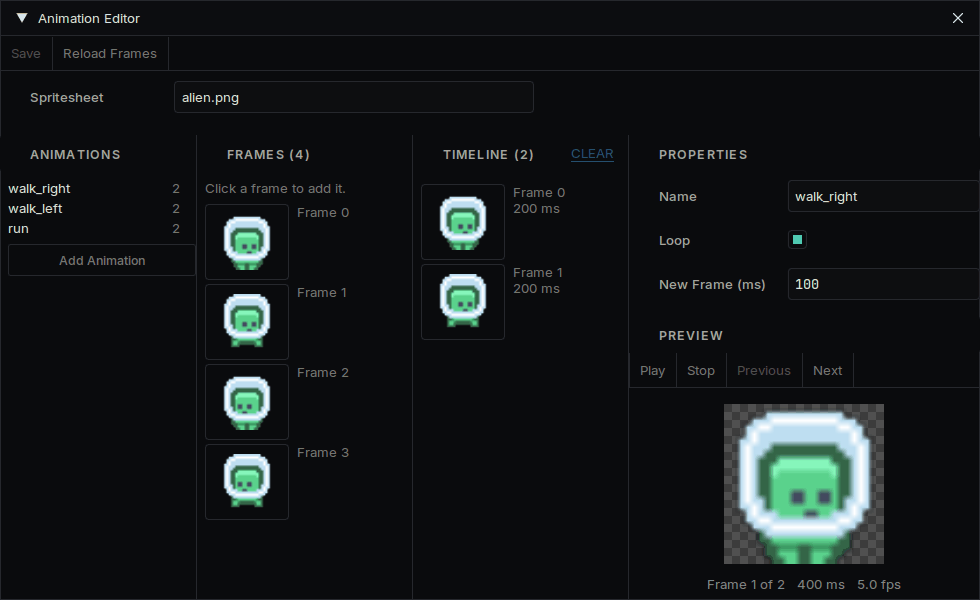

# Animation

There are two kinds: frames that play one after another, and values that change smoothly over time.

## Frame animation

First cut your image into frames: see [Sprites](sprites.md). Then:

1. In the Asset Browser, right-click a folder and choose **Create... → Animation**.
2. Double-click the new file. The **Animation Editor** opens.
3. Pick your image under **Spritesheet**.
4. Click frames to add them to the timeline, and set **New Frame (ms)** for how long each one is held.
5. Press **Add Animation** for each other animation, such as `idle` and `walk`, and give each a **Name**.
6. Press **Save**.



On your object, add a **Sprite Component** and an **Animation Component**, and choose the file in **Animation**. It plays the first animation when the game runs.

## Choosing what plays

Use the names you gave them:

```cpp
#include "AnimationComponent.h"

auto* animation = GetOwner()->GetComponent<Deki2D::AnimationComponent>();
animation->PlayAnimation("walk");
```

| Call | What it does |
| --- | --- |
| `PlayAnimation("walk")` | Plays it, and leaves it alone if it is already playing |
| `PlayAnimationOnce("hit")` | Plays it once, even if it loops |
| `Pause()`, `Resume()` | Freezes it on the current frame, and continues |
| `Stop()` | Stops and shows the first frame |

To do something when an animation that does not loop ends:

```cpp
animation->SetCompletionCallback([animation]() { animation->PlayAnimation("idle"); });
```

Calling `PlayAnimation` every frame is fine: it does not restart what is already playing.

## Smooth movement

The **deki-tween** package moves an object without code. Install it from the Package Manager, then add a **Tween Component** to the object.

| Field | What it does |
| --- | --- |
| **Target Type** | What changes: position, scale or rotation |
| **End Value** | Where it arrives |
| **Duration** | How long one pass takes, in seconds |
| **Ease Type** | The shape of the motion. Ease-in-out looks natural for most things |
| **Loops** | 0 runs once, -1 repeats forever |
| **Ping Pong** | Goes back again on alternate passes |
