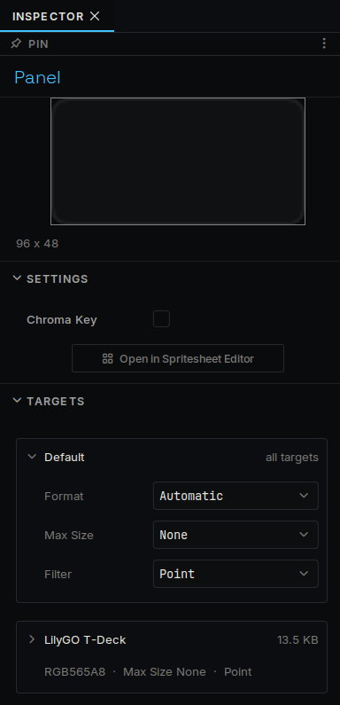

# Asset System

## AssetRef\<T\> Template



**File:** `deki-engine/include/deki/assets/AssetRef.h`

Every component that references an asset uses `AssetRef<T>`. It has four fields:

| Field | Type | Purpose |
|-------|------|---------|
| `guid` | `std::string` | The GUID used to **load the asset from disk**. Always points to an actual file. |
| `source` | `std::string` | Context-dependent metadata. See "Dual-Field Pattern" below. |
| `ptr` | `void*` | Cached pointer to the loaded asset. Set on first `Get()`. |
| `loadAttempted` | `bool` | Prevents retry spam. Set to `true` after first load attempt. |

### Lazy Loading

`Get()` triggers a one-time load:

```
if (!ptr && !guid.empty() && !loadAttempted) {
    loadAttempted = true;
    ptr = static_cast<T*>(AssetManager::Get()->LoadByGuidAndType(guid, T::kAssetTypeName));
}
return ptr;
```

To force a reload after changing `guid`, you must clear both `ptr` and `loadAttempted`:
```cpp
ref.guid = newGuid;
ref.ptr = nullptr;
ref.loadAttempted = false;
```

## Dual-Field Pattern (guid vs source)

The `guid` and `source` fields have **different meanings** depending on the asset type. This is intentional and reflects a real architectural difference.

### Rule: `guid` always = "the file to load from disk"

| Asset type | `guid` | `source` | Why |
|------------|--------|----------|-----|
| **Sprite** (plain) | Sprite GUID | (empty) | Single file, no indirection |
| **Sprite** (frame) | **Parent** sprite GUID | **Frame** GUID | The parent .tex file contains all frames. `guid` loads the file, `source` identifies the frame region. |
| **Font** | **Variant** GUID (baked) | **TTF** source GUID | Each font size is a separate file. `guid` loads the baked variant directly. |
| **Animation** | Animation GUID | (empty) | Single file |

### Why sprites and fonts differ

- **Font variants are separate files.** A font at 16px and 24px produce different .dfont + atlas files. The variant GUID points directly to that file.
- **Sprite frames are regions of one file.** Frame 0 and frame 5 are sub-regions of the same .tex file. The parent GUID points to the whole texture. The frame GUID is only used for coordinate lookup via `FindFrame()`.

### Generated code pattern

The code generator produces `ResolveObjectRefs` with:
```cpp
const char* _frameGuid = ref.source.empty() ? ref.guid.c_str() : ref.source.c_str();
OnAssetRefResolved(propertyName, loadedAsset, _frameGuid);
```

This ensures `OnAssetRefResolved` receives the **meaningful identifier** (frame GUID for sprites, TTF source for fonts) regardless of which field it's stored in.

## Deterministic GUID Generation

Virtual/derived assets use deterministic GUIDs generated from a seed string via `GenerateDeterministicGuid()` (dual 64-bit FNV-1a hash, formatted as UUID).

### Seed Formats (NEVER CHANGE THESE)

| Virtual Asset | Seed Format | Example |
|---------------|-------------|---------|
| Font variant | `sourceGuid + ":" + fontSize` | `"abc-123:16"` |
| Font atlas | `sourceGuid + ":" + fontSize + ":atlas"` | `"abc-123:16:atlas"` |
| Sprite frame | `parentGuid + ":" + frameIndex` | `"abc-123:0"` |
| Preview font | `"preview:" + sourceGuid + ":" + fontSize` | `"preview:abc-123:16"` |
| Package asset with no .data | `"package-asset:" + projectRelativePath` | `"package-asset:packages/deki-terrain/assets/shaders/terrain.shader"` |

The `"preview:"` prefix prevents collision with real font variant GUIDs.

### Where deterministic GUIDs are generated

- `deki-engine/src/Guid.cpp` - Core implementation
- `../../packages/deki-2d/editor/FontSyncHandler.cpp` - Font baking
- `../../packages/deki-2d/TextComponent.cpp` - Edit mode font.guid sync
- `src/services/AssetExporter.cpp` - Export-time baking
- `src/PlayMode.cpp` - Play mode font setup
- `deki-editor/src/AssetPipeline.cpp` - Cache management
- `deki-editor/src/TextureImporter.cpp` - Sprite frame generation

## Package assets

A package can ship assets: a shader, a model, an image, a sample scene. They
go in the package's own `assets` folder, and nothing needs declaring in
`package.json`:

```
packages/deki-terrain/
  assets/
    shaders/terrain.shader
```

The editor imports `packages/<id>/assets/` of every package in the project as
it imports the project's `assets/`, and they are referred to the same way, by
GUID. Their project-relative path is `packages/<id>/assets/...`.

- **Same GUID in every project.** Commit each file's `.data` with the
  package. A file without one gets a GUID made from its path (above), so it
  is the same in every project the package is in.
- **Read only.** The Asset Browser lists them under **Packages**, one folder a
  package, and will not rename, move, delete or add to them. **Copy to Assets**
  copies one into the project's `assets/`, with a new GUID, to change there.
- **In the pickers.** An asset field's picker lists a package's assets under
  `Packages/<id>/`. A field of a registered asset type (a Shader, a Mesh) lists
  the files of that type.
- **Shipped when used.** A build takes a package's asset only when one of the
  project's scenes uses it. A package's own scenes are not roots of a build.
- **Links are followed as written.** A package folder can be a link (a
  junction) to a checkout elsewhere; its assets keep their
  `packages/<id>/assets/...` paths.
- **Lookup keys.** The `path:type` key of a project asset drops the leading
  `assets/`; a package asset keeps its whole path, so the two never share a key.

Not yet: a package installed or removed while the editor is open is picked up
when the project is opened again, and the stripping scan does not read a
package's scenes.

## Asset Lookup Table (asset_table.bin)

**Binary format** for O(log n) runtime lookup:

```
[4 bytes]  entry count (uint32_t)
[N entries, 44 bytes each, sorted by hash]:
  [4 bytes]  FNV-1a hash of key (uint32_t)
  [37 bytes] GUID string (null-terminated)
  [3 bytes]  padding
```

### Hash function (FNV-1a 32-bit)

```
offset_basis = 2166136261
prime = 16777619
```

**NEVER change these constants.** They must match between:
- `src/services/AssetExporter.cpp` (export side)
- `deki-engine/include/deki/assets/AssetLookupTable.h` (runtime side)
- `deki-editor/src/AssetPipeline.cpp` (editor cache)

### Key types in the table

| Key format | Maps to | Used by |
|------------|---------|---------|
| `"path:type"` (e.g., `"textures/player:Sprite"`) | Asset GUID | `AssetManager::Load<T>("path")` |
| GUID string (e.g., `"abc-123-..."`) | Same GUID | Direct GUID lookup for baked fonts |

### Two versions of the table

| File | Scope | Written by |
|------|-------|------------|
| `cache/asset_table.bin` | All project assets | `AssetPipeline::UpdateAssetTable()` |
| `<build's assets>/asset_table.bin` | Only used assets | `AssetExporter::ExportAssetLookupTable()` |

A build's assets are exported next to its boot payload (`assets/`, read as `F:/assets/`) when
the target keeps them in internal storage, or to `<project>/storage/` for an SD card (`S:/`).
`AssetManager::LoadAssetRoot` loads the table, the pack index and every asset from there; see
[platforms.md](platforms.md#where-the-assets-go).

## Asset Loading Flow

```
AssetRef::Get()
  -> AssetManager::LoadByGuidAndType(guid, T::kAssetTypeName)
    -> LookupPath(guid)
      -> Check binary asset_table.bin (binary search by FNV-1a hash)
      -> Check guidToPath_ map (runtime registrations)
      -> Return: cacheDirectory + "/" + resolved path
    -> Load<T>(resolvedPath)  // Sprite::Load, BitmapFont::Load, etc.
```

## Key Files

| File | Purpose |
|------|---------|
| `deki-engine/include/deki/assets/AssetRef.h` | AssetRef template |
| `deki-engine/src/assets/AssetManager.cpp` | GUID lookup, asset loading |
| `deki-engine/include/deki/assets/AssetLookupTable.h` | Binary table format + FNV-1a |
| `deki-engine/src/Guid.h` / `.cpp` | Deterministic GUID generation |
| `deki-editor/src/AssetPipeline.cpp` | GUID assignment, cache management |
| `src/services/AssetExporter.cpp` | Export pipeline |
