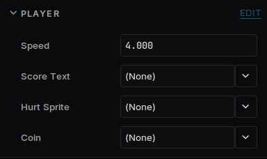

# Components

Everything an object does comes from its components. This page is how to write your own.

## A small one

In the Asset Browser, open **Scripts**, right-click and choose **Create C++ Script**. Replace the two files with this:

`src/Player.h`:

```cpp
#pragma once

#include <deki/Engine.h>

DEKI_CATEGORY("Game")
DEKI_DESCRIPTION("Moves the player.")
class Player : public Deki::Component
{
public:
    DEKI_EXPORT
    DEKI_TOOLTIP("How fast it moves, in meters per second.")
    DEKI_RANGE(0, 20)
    float speed = 4.0f;

    void Update() override;
};
```

`src/Player.cpp`:

```cpp
#include "Player.h"

void Player::Update()
{
    // The time since the last frame is in milliseconds.
    const float seconds = Deki::Time::GetDeltaTimeF() * 0.001f;
    Deki::Object* me = GetOwner();
    me->SetWorldPosition(me->GetWorldX() + speed * seconds, me->GetWorldY());
}
```

Save, and the editor rebuilds your code. **Add Component** now lists **Player**.

## Fields in the Inspector

`DEKI_EXPORT` shows a field in the Inspector and saves it in the scene. It works on numbers, `bool`, `std::string`, `Deki::Color` and references to objects and assets.



`DEKI_TOOLTIP` adds the text shown on hover, and `DEKI_RANGE` limits the value.

## When your code runs

| Method | When |
| --- | --- |
| `Awake` | Once, when the object is ready. Set up the component itself here. |
| `Start` | Once, after every `Awake`. Talk to other components here. |
| `Update` | Every frame. |

Declare only the ones you need. A component with no `Update` costs nothing per frame.

## Other components

On the same object:

```cpp
#include "SpriteComponent.h"

auto* sprite = GetOwner()->GetComponent<Deki2D::SpriteComponent>();
```

To reach another object, add a field and pick the object in the Inspector:

```cpp
#include <deki/reflection/ObjectRef.h>
#include "TextComponent.h"

DEKI_EXPORT
Deki::ObjectRef<Deki2D::TextComponent> scoreText;
```

```cpp
scoreText.Get()->SetText("Score: 10");
```

`Get()` returns nothing if the field is empty or the object has gone, so check it when either can happen. You can also find an object by name:

```cpp
Deki::Scene* scene = GetOwner()->GetOwnerScene();
Deki::Object* door = scene->FindDekiObject("Door");
```

## Making and removing objects

```cpp
Deki::Object* coin = scene->CreateDekiObject("Coin");
coin->SetWorldPosition(1.0f, 2.0f);
coin->AddComponent<Spin>();
```

To make many copies of something you built in the editor, save it as its own scene and point a field at it. Each call makes a copy and returns its root:

```cpp
#include <deki/assets/AssetRef.h>

DEKI_EXPORT
Deki::AssetRef<Deki::Scene> coinScene;
```

```cpp
Deki::Object* copy = coinScene->Instantiate(scene, 3.0f, 1.0f);
```

Remove an object with `scene->DestroyDekiObject(coin)`. It is safe from inside any component, including one on that object.

## Changing scene

```cpp
DEKI_EXPORT
Deki::AssetRef<Deki::Scene> nextLevel;
```

```cpp
Deki::Engine::GetInstance().OpenScene(nextLevel);
```

The old scene is freed before the next one loads, so the two are never in memory together.

## Printing to the Console

```cpp
DEKI_LOG_INFO("Score: %d", score);
```

`DEKI_LOG_WARNING` and `DEKI_LOG_ERROR` work the same way. They need `#include <deki/LogSystem.h>`. On a device the text goes to the serial port.
