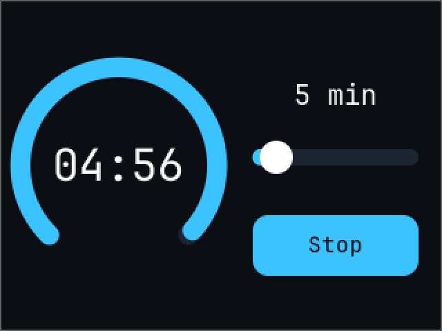
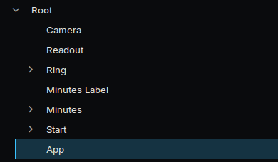
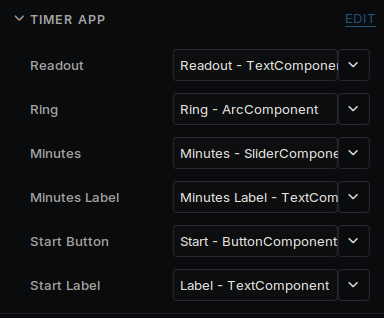

# Your first app

%Deki also makes apps for devices: dashboards, tools, controllers. This one is a countdown timer with a dial, a slider and a button.



It starts from a new project: see [Getting started](getting-started.md). The Inspector shows sizes in pixels, with 16 pixels to the meter by default.

## Lay out the screen

Every widget is a component on an object. Adding one makes its parts as children, and each part can be coloured on its own.

1. Delete **Sky**, and set the **Camera**'s **Clear Color** to `#0B0F14`.
2. Rename **Hello** to **Readout**. Set its position to -74, 0, **Width** to 144, **Height** to 64, **Align** to **Center**, **Font Size** to 32, **Sorting Order** to 10 and its text to `05:00`.
3. Make an empty object called **Ring** at -74, 0 and add an **Arc Component**. Set **Size** to 157, **Thickness** to 14, **Value** to 100, and turn off **Interactive**. In its children, colour **Track** `#1C2530` and **Indicator** `#3BC3FF`.
4. Duplicate **Readout** and name it **Minutes Label**. Set its position to 83, 51, **Width** to 128, **Height** to 32, **Font Size** to 20 and its text to `5 min`.
5. Make an empty object called **Minutes** at 83, 6 and add a **Slider Component**. Set **Min Value** to 1, **Max Value** to 30, **Value** to 5, **Step** to 1 and **Width** to 120. In its children, colour **Track** `#1C2530`, **Fill** `#3BC3FF` and **Knob** white.

## The button

A button is an object with something to see and an area to press.

1. Make an object called **Start** at 83, -58.
2. Add a **Shape Component**. Set **Width** to 120, **Height** to 44, **Corner Radius** to 11, **Color** to `#3BC3FF` and **Sorting Order** to 5.
3. Add an **Input Collider** with the same **Width** and **Height**.
4. Add a **Button Component** and set its **Input Collider** field to this object.
5. Duplicate **Minutes Label**, drag the copy onto **Start** and name it **Label**. Set its position to 0, 0, **Width** to 120, **Height** to 44, **Font Size** to 16, **Color** to `#0B0F14`, **Sorting Order** to 6 and its text to `Start`.



## The code

Make an empty object called **App**, create a script called `TimerApp`, and replace its files.

`src/TimerApp.h`:

```cpp
#pragma once

#include <deki/Engine.h>
#include <deki/reflection/ObjectRef.h>

#include "ArcComponent.h"
#include "ButtonComponent.h"
#include "SliderComponent.h"
#include "TextComponent.h"

DEKI_CATEGORY("App")
DEKI_DESCRIPTION("A countdown timer.")
class TimerApp : public Deki::Component
{
public:
    DEKI_EXPORT
    Deki::ObjectRef<Deki2D::TextComponent> readout;

    DEKI_EXPORT
    Deki::ObjectRef<Deki2D::ArcComponent> ring;

    DEKI_EXPORT
    Deki::ObjectRef<Deki2D::SliderComponent> minutes;

    DEKI_EXPORT
    Deki::ObjectRef<Deki2D::TextComponent> minutesLabel;

    DEKI_EXPORT
    Deki::ObjectRef<Deki2D::ButtonComponent> startButton;

    DEKI_EXPORT
    Deki::ObjectRef<Deki2D::TextComponent> startLabel;

    void Start() override;
    void Update() override;

private:
    void SetMinutes(float value);
    void StartOrStop();
    void Show(int secondsLeft);

    bool m_Running = false;
    float m_Total = 0.0f;
    float m_Left = 0.0f;
    int m_Shown = -1;
};
```

`src/TimerApp.cpp`:

```cpp
#include "TimerApp.h"

#include <cmath>
#include <cstdio>

void TimerApp::Start()
{
    minutes.Get()->AddOnValueChangedCallback([this](float value) { SetMinutes(value); });
    startButton.Get()->AddOnClickCallback([this]() { StartOrStop(); });
    SetMinutes(minutes.Get()->GetValue());
}

void TimerApp::SetMinutes(float value)
{
    char line[16];
    std::snprintf(line, sizeof(line), "%d min", static_cast<int>(value));
    minutesLabel.Get()->SetText(line);

    if (!m_Running)
    {
        m_Total = value * 60.0f;
        m_Left = m_Total;
        Show(static_cast<int>(m_Total));
    }
}

void TimerApp::StartOrStop()
{
    m_Running = !m_Running;
    startLabel.Get()->SetText(m_Running ? "Stop" : "Start");

    m_Total = minutes.Get()->GetValue() * 60.0f;
    m_Left = m_Total;
    Show(static_cast<int>(m_Total));
}

void TimerApp::Update()
{
    if (!m_Running)
    {
        return;
    }

    m_Left -= Deki::Time::GetDeltaTimeF() * 0.001f;
    if (m_Left <= 0.0f)
    {
        m_Left = 0.0f;
        m_Running = false;
        startLabel.Get()->SetText("Start");
    }
    Show(static_cast<int>(std::ceil(m_Left)));
}

void TimerApp::Show(int secondsLeft)
{
    // Only when the number changes: a screen that does not change costs nothing to draw.
    if (secondsLeft == m_Shown)
    {
        return;
    }
    m_Shown = secondsLeft;

    char line[16];
    std::snprintf(line, sizeof(line), "%02d:%02d", secondsLeft / 60, secondsLeft % 60);
    readout.Get()->SetText(line);
    ring.Get()->SetValue(100.0f * secondsLeft / m_Total);
}
```

Add the **Timer App** component to the App object and fill in its six fields.



Save with Ctrl+S and press **Run**. Drag the slider, then press the button.

## On a device

Turn on **Redraw Changes** in **Project Settings → Rendering**. Each frame then draws and sends only what changed, which here is a few digits and the end of the ring, once a second. `Show` helps by doing nothing until the number changes. The [Speed](performance.md) tools show the difference.

Every widget also works without a touchscreen: Tab and the arrow keys move the focus, and Enter presses. See [UI widgets](ui-widgets.md).

To run it on one, follow the last part of [Getting started](getting-started.md).

## Take it further

**A second screen.** Save another scene, then open it from a button:

```cpp
#include <deki/assets/AssetRef.h>

DEKI_EXPORT
Deki::AssetRef<Deki::Scene> settingsScreen;
```

```cpp
settingsButton.Get()->AddOnClickCallback(
    [this]() { Deki::Engine::GetInstance().OpenScene(settingsScreen); });
```

**A setting.** Add a **Switch Component** and listen to it:

```cpp
sound.Get()->AddOnToggledCallback([this](bool on) { m_SoundOn = on; });
```

**More widgets.** Lists, dropdowns, charts, tabs and a text box with an on-screen keyboard are in [UI widgets](ui-widgets.md). To fit other screen sizes, see [Screens](screens.md).
