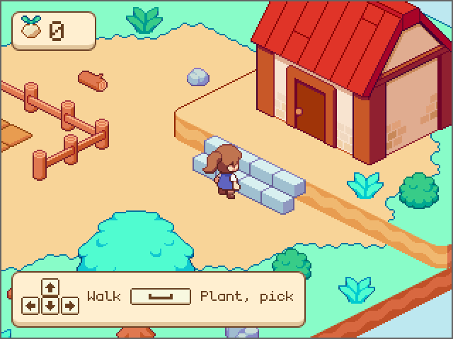
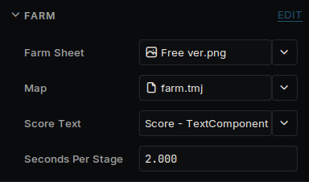

# Your first game

A tiny farm. Walk around the island, plant turnips and watch them grow. Pick the ripe ones into a tower on the farmer's head, then carry it up the steps to the house to sell. It plays with a keyboard, a handheld's buttons or taps, and shows the controls for whichever the player uses.



It starts from a new project: see [Getting started](getting-started.md). The Inspector shows sizes in pixels and code uses meters, with 16 pixels to the meter by default: see [Units](units.md).

## Get the art and the island

The art is [Simple Cozy - Farm Asset Pack](https://aibyzz.itch.io/sc-farm-pack) by Aibyzz. Download the free version and unpack it. Deki does not include it, because its licence does not allow sharing the files. You can use it in your own games, commercial ones too.

The island is a [Tiled](https://www.mapeditor.org) map, ready to use, in <a href="first-game-files.zip">first-game-files.zip</a>. The zip also holds the map's four tilesets, the HUD's icons and panel and the [monogram](https://datagoblin.itch.io/monogram) pixel font. The ground is painted on tile layers, steps included, and everything that stands on it, from the fences to the house, is a tile object on the `scenery` layer.

Three rectangles on that layer are for the game, not to be seen: `Steps` marks where the steps climb, the house's `Wall` keeps the farmer out of the house and the ground behind it, and `Door` is the ground in front of the door, where turnips are sold. Tiled has no levels, so whatever stands on the raised ground has a custom property, `level`, set to 1.

1. Open **View → Package Manager** and install **Tiled Map Editor Integration**.
2. Unpack the zip into your project's `assets` folder. It makes the folders `tilemaps`, `hud` and `fonts` there.
3. From the art pack, copy `Farm/Free ver.png`, `Farm/Objects.png` and `Farm/House.png` into `assets/tilemaps`. The tilesets look for them there.
4. Drag `Player/FPlayer 1 idle.png` and `Player/FPlayer 1 walking.png` onto the Asset Browser.
5. Select `monogram` in the Asset Browser and set its **Hinting Mode** to **Mono (1-bit, no AA)**. A pixel font then draws crisp, with no smoothed edges, like the art around it. It is drawn for size 16: one of its pixels to one on the screen.

## The scene

The island is bigger than the screen, so the camera follows the farmer.

1. Delete **Sky**.
2. On **Camera**, set **Clear Color** to `#BDE8F0` and turn on **Pixel Perfect**. The art is then scaled by whole numbers only, so on a screen bigger than the game every pixel of it is the same size.
3. Make an empty object called **Map** at 0, 8. Add a **Tilemap Component** and set its **Tilemap** to `farm`. Then add a **Tilemap Object Spawner**, set its **Tilemap** to `farm`, **Sort Base** to 1000 and **Sort Per Meter** to 16, one order for each pixel row. The spawner is what turns the `scenery` layer into sprites when the game starts.
4. Make an empty object called **Tap Area**, drag it onto **Camera** and add an **Input Collider** with **Width** 640 and **Height** 480. It covers the screen, and a wider one too, so every tap or click lands on it.
5. Make two empty objects, **Farm** and **Farmer**. Set the Farmer's position to 40, -16 and add a **Sprite Component** to it. Leave its **Sprite** empty: the code sets it.

## The farm

The map holds the island, so this script is only the game: where the soil is, how the turnips grow, the score, where the farmer can walk and the way from one spot to another. Create a script called `Farm`.

`src/Farm.h`:

```cpp
#pragma once

#include <deki/Engine.h>
#include <deki/assets/AssetRef.h>
#include <deki/providers/Buffer.h>
#include <deki/reflection/ObjectRef.h>

#include <cmath>

#include "SpriteBatchComponent.h"
#include "SpriteComponent.h"
#include "Tilemap.h"
#include "TextComponent.h"

DEKI_CATEGORY("Game")
DEKI_DESCRIPTION("Grows the turnips, counts the ones sold and says where the farmer can walk.")
class Farm : public Deki::Component
{
public:
    DEKI_EXPORT
    Deki::AssetRef<Deki2D::Sprite> farmSheet;

    DEKI_EXPORT
    Deki::AssetRef<DekiTiledMap::Tilemap> map;

    DEKI_EXPORT
    Deki::ObjectRef<Deki2D::TextComponent> scoreText;

    DEKI_EXPORT
    float secondsPerStage = 2.0f;

    void Start() override;
    void Update() override;

    // How high the ground is at this point, given as if it were on the lower
    // ground: 0 there, 1 on the raised ground and in between on the steps.
    // -1 where no one can stand.
    float GroundHeight(float x, float y) const;

    // Finds the way from one point to the spot nearest another that can be
    // reached, round whatever is in between. False when there is none.
    bool FindWay(float fromX, float fromY, float x, float y);

    // The next point of that way to walk straight to. False once there.
    bool NextPoint(float fromX, float fromY, float& outX, float& outY) const;

    // Plants on the empty patch nearest this point. A ripe turnip there is
    // picked when there is room to carry it: true when one was.
    bool UseSoil(float x, float y, bool canCarry);

    // Whether this point is in front of the house door, where turnips are sold.
    bool IsAtDoor(float x, float y) const;

    // Counts a turnip as sold.
    void Sell();

    // Whether this point is on a patch of soil.
    bool IsSoil(float x, float y) const;

    // What stands nearer the bottom of the screen draws on top, one order
    // per pixel row, as the map's spawner sorts the scenery.
    static int DrawOrder(float y) { return 1000 - static_cast<int>(std::floor(y * 16.0f)); }

private:
    // Something on the map's scenery layer, in columns and rows of the ground
    // it stands on.
    struct Thing
    {
        enum Kind : uint8_t
        {
            Solid,  // in the way around its point
            Wall,   // in the way over its whole area
            Steps,  // climbs one level, from its front edge to its back
            Door,   // where turnips are sold; not in the way
        };

        float column = 0.0f;
        float row = 0.0f;
        float columns = 0.0f;  // an area's size
        float rows = 0.0f;
        int level = 0;
        Kind kind = Solid;

        bool Holds(float c, float r) const
        {
            return c >= column && c <= column + columns && r >= row && r <= row + rows;
        }
    };

    struct Patch
    {
        float x = 0.0f;
        float y = 0.0f;
        // Pieces of the soil and crop batches.
        uint32_t soil = 0;
        uint32_t crop = 0;
        int stage = -1;  // -1: nothing planted
        float age = 0.0f;
    };

    void ReadMap();
    void FindWays();
    bool CanWalk(float fromX, float fromY, float toX, float toY) const;
    void Flood(int from);
    void Show(Patch& patch);
    void ShowScore();

    Patch m_Patches[20];
    // Every patch's soil, and every patch's turnip, each one batch.
    Deki2D::SpriteBatchComponent* m_Soil = nullptr;
    Deki2D::SpriteBatchComponent* m_Crops = nullptr;
    int m_Score = 0;

    Deki::Buffer<Thing> m_Things;
    // For each square of the island: which of the eight around it can be
    // walked to, and how many squares away the last flood started.
    Deki::Buffer<uint8_t> m_Ways;
    Deki::Buffer<uint16_t> m_Steps;
    Deki::Buffer<uint16_t> m_Queue;
    float m_GoalX = 0.0f;
    float m_GoalY = 0.0f;
};
```

`src/Farm.cpp`:

```cpp
#include "Farm.h"

#include <cmath>
#include <cstdio>
#include <cstring>

namespace
{
const int kIslandSize = 24;
const int kSquares = kIslandSize * kIslandSize;
const float kIslandTop = 12.0f;

// The first column and last row of the raised ground, where the house stands.
const float kRaisedColumn = 11.6f;
const float kRaisedRow = 9.6f;

// How close to a fence, rock or tree the farmer can get, in squares.
const float kSolidRadius = 0.5f;

// The eight squares around one, as columns and rows, and a square the flood
// did not reach.
const int kAround[8][2] = { { 1, 0 }, { 1, 1 }, { 0, 1 }, { -1, 1 }, { -1, 0 }, { -1, -1 }, { 0, -1 }, { 1, -1 } };
const uint16_t kNoWay = 0xFFFF;

// Two points this close are the same spot, in meters.
const float kSameSpot = 0.01f;

// Tiled stores positions at 16 per square, and the map's grid starts 2 squares
// before the island.
const float kMapUnitsPerSquare = 16.0f;
const float kMapMargin = 2.0f;

// The middle of a square on the lower ground. A square is 2 meters wide and
// 1 tall, and the raised ground is 1 meter higher.
float WorldX(float column, float row)
{
    return column - row;
}

float WorldY(float column, float row)
{
    return kIslandTop - (column + row) * 0.5f;
}

// The column and row of a point on the lower ground.
float ColumnAt(float x, float y)
{
    return kIslandTop - y + x * 0.5f;
}

float RowAt(float x, float y)
{
    return kIslandTop - y - x * 0.5f;
}

bool IsOnIsland(int column, int row)
{
    return column >= 0 && row >= 0 && column < kIslandSize && row < kIslandSize;
}

// How far apart two points are in squares. On this view a meter up the
// screen is twice as far over the ground as a meter across.
float Squares(float fromX, float fromY, float toX, float toY)
{
    return std::hypot(toX - fromX, (toY - fromY) * 2.0f) / 1.41f;
}

bool IsA(const DekiTiledMap::DTilemapObject& object, const char* type)
{
    return std::strncmp(object.type, type, sizeof(object.type)) == 0;
}
}  // namespace

void Farm::ReadMap()
{
    const DekiTiledMap::Tilemap& tilemap = *map.Get();
    const auto& objects = tilemap.Objects();
    if (!m_Things.Allocate(objects.size(), Deki::Memory::External))
    {
        return;
    }

    for (size_t index = 0; index < objects.size(); ++index)
    {
        const DekiTiledMap::DTilemapObject& object = objects[index];
        // Tiled has no levels, so whatever stands on the raised ground has a
        // "level" property of 1. Tiled shows it where it would be on the
        // lower ground: a square further up and to the left.
        const DekiTiledMap::DTilemapProperty* level = tilemap.FindProperty(object, "level");
        Thing thing;
        thing.level = level ? level->intValue : 0;
        thing.column = object.x / kMapUnitsPerSquare - kMapMargin + thing.level;
        thing.row = object.y / kMapUnitsPerSquare - kMapMargin + thing.level;
        thing.columns = object.width / kMapUnitsPerSquare;
        thing.rows = object.height / kMapUnitsPerSquare;
        thing.kind = IsA(object, "Steps")  ? Thing::Steps
                     : IsA(object, "Wall") ? Thing::Wall
                     : IsA(object, "Door") ? Thing::Door
                                           : Thing::Solid;
        m_Things[index] = thing;
    }
}

void Farm::FindWays()
{
    if (!m_Ways.Allocate(kSquares, Deki::Memory::External) || !m_Steps.Allocate(kSquares, Deki::Memory::External) ||
        !m_Queue.Allocate(kSquares, Deki::Memory::External))
    {
        m_Ways.Reset();
        return;
    }

    // Which squares can be walked between never changes, so it is worked out
    // once: from the middle of each to the middle of each one around it. A
    // way that can be walked one way can be walked back.
    std::memset(m_Ways.Data(), 0, kSquares);
    for (int row = 0; row < kIslandSize; ++row)
    {
        for (int column = 0; column < kIslandSize; ++column)
        {
            for (int way = 0; way < 4; ++way)
            {
                const int nextColumn = column + kAround[way][0];
                const int nextRow = row + kAround[way][1];
                if (IsOnIsland(nextColumn, nextRow) &&
                    CanWalk(WorldX(column, row), WorldY(column, row), WorldX(nextColumn, nextRow),
                            WorldY(nextColumn, nextRow)))
                {
                    uint8_t& there = m_Ways[row * kIslandSize + column];
                    uint8_t& back = m_Ways[nextRow * kIslandSize + nextColumn];
                    there = static_cast<uint8_t>(there | (1 << way));
                    back = static_cast<uint8_t>(back | (1 << (way + 4)));
                }
            }
        }
    }
}

void Farm::Start()
{
    ReadMap();
    FindWays();

    Deki2D::Sprite* farm = farmSheet.Get();

    // Every patch's soil in one batch, and every turnip in another, each
    // piece sorted on its own, at world (0, 0).
    Deki::Object* beds = GetOwner()->GetOwnerScene()->CreateDekiObject("Beds");
    beds->SetWorldPosition(0.0f, 0.0f);
    m_Soil = beds->AddComponent<Deki2D::SpriteBatchComponent>();
    m_Soil->sprite = farm;
    m_Crops = beds->GetOwnerScene()->CreateDekiObject("Crops")->AddComponent<Deki2D::SpriteBatchComponent>();
    m_Crops->sprite = farm;

    // Two long beds of soil, with a path to the gate between them.
    int next = 0;
    for (int row : { 13, 14, 16, 17 })
    {
        for (int column = 4; column <= 8; ++column)
        {
            Patch& patch = m_Patches[next++];
            patch.x = WorldX(column, row);
            patch.y = WorldY(column, row);
            patch.soil = static_cast<uint32_t>(m_Soil->Add(patch.x, patch.y + 0.5f, 128, 0, 32, 32, 100));
            patch.crop =
                static_cast<uint32_t>(m_Crops->Add(patch.x, patch.y + 0.5f, 0, 96, 32, 32, DrawOrder(patch.y - 0.5f)));
            m_Crops->SetVisible(patch.crop, false);
        }
    }

    ShowScore();
}

void Farm::Update()
{
    const float seconds = Deki::Time::GetDeltaTimeF() * 0.001f;
    for (Patch& patch : m_Patches)
    {
        if (patch.stage < 0 || patch.stage == 3)
        {
            continue;
        }

        patch.age += seconds;
        if (patch.age >= secondsPerStage)
        {
            patch.age = 0.0f;
            ++patch.stage;
            Show(patch);
        }
    }
}

float Farm::GroundHeight(float x, float y) const
{
    const float column = ColumnAt(x, y);
    const float row = RowAt(x, y);

    const float last = kIslandSize - 1;
    if (column < -0.3f || row < -0.3f || column > last + 0.3f || row > last + 0.3f)
    {
        return -1.0f;
    }

    float height = column > kRaisedColumn && row < kRaisedRow ? 1.0f : 0.0f;
    for (size_t index = 0; index < m_Things.Count(); ++index)
    {
        const Thing& thing = m_Things[index];
        if (thing.kind == Thing::Steps && thing.Holds(column, row))
        {
            height = (thing.row + thing.rows - row) / thing.rows;
        }
    }

    // Everything else on the map is in the way of whoever is on its level.
    const int level = height < 0.5f ? 0 : 1;
    for (size_t index = 0; index < m_Things.Count(); ++index)
    {
        const Thing& thing = m_Things[index];
        if (thing.kind == Thing::Steps || thing.kind == Thing::Door || thing.level != level)
        {
            continue;
        }
        const float columns = thing.column - column;
        const float rows = thing.row - row;
        const bool inTheWay = thing.kind == Thing::Wall ? thing.Holds(column, row)
                                                        : columns * columns + rows * rows < kSolidRadius * kSolidRadius;
        if (inTheWay)
        {
            return -1.0f;
        }
    }
    return height;
}

bool Farm::CanWalk(float fromX, float fromY, float toX, float toY) const
{
    // Looks six times a square: close enough to see a fence, and the cliff as
    // a drop of more than half a level between two looks.
    const int looks = 1 + static_cast<int>(Squares(fromX, fromY, toX, toY) * 6.0f);
    float height = GroundHeight(fromX, fromY);
    for (int look = 1; look <= looks && height >= 0.0f; ++look)
    {
        const float part = static_cast<float>(look) / looks;
        const float next = GroundHeight(fromX + (toX - fromX) * part, fromY + (toY - fromY) * part);
        if (next < 0.0f || std::fabs(next - height) >= 0.5f)
        {
            return false;
        }
        height = next;
    }
    return height >= 0.0f;
}

void Farm::Flood(int from)
{
    // Spreads out from one square, a square further each round, so every
    // square it reaches learns how many squares away it is.
    for (int square = 0; square < kSquares; ++square)
    {
        m_Steps[square] = kNoWay;
    }
    int first = 0;
    int count = 0;
    m_Steps[from] = 0;
    m_Queue[count++] = static_cast<uint16_t>(from);
    while (first < count)
    {
        const int square = m_Queue[first++];
        for (int way = 0; way < 8; ++way)
        {
            const int next = square + kAround[way][0] + kAround[way][1] * kIslandSize;
            if ((m_Ways[square] & (1 << way)) && m_Steps[next] == kNoWay)
            {
                m_Steps[next] = static_cast<uint16_t>(m_Steps[square] + 1);
                m_Queue[count++] = static_cast<uint16_t>(next);
            }
        }
    }
}

bool Farm::FindWay(float fromX, float fromY, float x, float y)
{
    if (!m_Ways)
    {
        return false;
    }

    // Starts from the nearest square whose middle can be walked straight to:
    // the one under the point, or one beside it.
    const int column = static_cast<int>(std::floor(ColumnAt(fromX, fromY) + 0.5f));
    const int row = static_cast<int>(std::floor(RowAt(fromX, fromY) + 0.5f));
    int start = -1;
    float nearest = 0.0f;
    for (int nextRow = row - 1; nextRow <= row + 1; ++nextRow)
    {
        for (int nextColumn = column - 1; nextColumn <= column + 1; ++nextColumn)
        {
            const float middleX = WorldX(nextColumn, nextRow);
            const float middleY = WorldY(nextColumn, nextRow);
            const float distance = Squares(fromX, fromY, middleX, middleY);
            if (IsOnIsland(nextColumn, nextRow) && (start < 0 || distance < nearest) &&
                CanWalk(fromX, fromY, middleX, middleY))
            {
                start = nextRow * kIslandSize + nextColumn;
                nearest = distance;
            }
        }
    }
    if (start < 0)
    {
        return false;
    }

    // A flood from there finds every square that can be reached. The goal is
    // the one nearest the point asked for: its own square when it is one.
    Flood(start);
    int goal = -1;
    for (int square = 0; square < kSquares; ++square)
    {
        const float middleX = WorldX(square % kIslandSize, square / kIslandSize);
        const float middleY = WorldY(square % kIslandSize, square / kIslandSize);
        const float distance = Squares(x, y, middleX, middleY);
        if (m_Steps[square] != kNoWay && (goal < 0 || distance < nearest))
        {
            goal = square;
            nearest = distance;
        }
    }

    // A second flood, from the goal, tells every square how far from it it
    // is. The way there is always to a square that is nearer.
    Flood(goal);
    m_GoalX = WorldX(goal % kIslandSize, goal / kIslandSize);
    m_GoalY = WorldY(goal % kIslandSize, goal / kIslandSize);
    if (CanWalk(m_GoalX, m_GoalY, x, y))
    {
        m_GoalX = x;
        m_GoalY = y;
    }
    return true;
}

bool Farm::NextPoint(float fromX, float fromY, float& outX, float& outY) const
{
    if (Squares(fromX, fromY, m_GoalX, m_GoalY) < kSameSpot)
    {
        return false;
    }

    // Straight to the goal when nothing is in between.
    if (CanWalk(fromX, fromY, m_GoalX, m_GoalY))
    {
        outX = m_GoalX;
        outY = m_GoalY;
        return true;
    }

    // Otherwise to the middle of a square: of the one under the point and the
    // eight around it, the nearest the goal that can be walked straight to.
    const int column = static_cast<int>(std::floor(ColumnAt(fromX, fromY) + 0.5f));
    const int row = static_cast<int>(std::floor(RowAt(fromX, fromY) + 0.5f));
    uint16_t fewest = kNoWay;
    for (int nextRow = row - 1; nextRow <= row + 1; ++nextRow)
    {
        for (int nextColumn = column - 1; nextColumn <= column + 1; ++nextColumn)
        {
            if (!IsOnIsland(nextColumn, nextRow))
            {
                continue;
            }
            const uint16_t steps = m_Steps[nextRow * kIslandSize + nextColumn];
            const float middleX = WorldX(nextColumn, nextRow);
            const float middleY = WorldY(nextColumn, nextRow);
            if (steps < fewest && Squares(fromX, fromY, middleX, middleY) >= kSameSpot &&
                CanWalk(fromX, fromY, middleX, middleY))
            {
                fewest = steps;
                outX = middleX;
                outY = middleY;
            }
        }
    }
    return fewest != kNoWay;
}

bool Farm::IsSoil(float x, float y) const
{
    for (const Patch& patch : m_Patches)
    {
        if (std::hypot(patch.x - x, (patch.y - y) * 2.0f) < 1.0f)
        {
            return true;
        }
    }
    return false;
}

bool Farm::IsAtDoor(float x, float y) const
{
    for (size_t index = 0; index < m_Things.Count(); ++index)
    {
        if (m_Things[index].kind == Thing::Door && m_Things[index].Holds(ColumnAt(x, y), RowAt(x, y)))
        {
            return true;
        }
    }
    return false;
}

void Farm::Sell()
{
    ++m_Score;
    ShowScore();
}

bool Farm::UseSoil(float x, float y, bool canCarry)
{
    Patch* nearest = nullptr;
    float best = 1.4f;
    for (Patch& patch : m_Patches)
    {
        const float distance = std::hypot(patch.x - x, (patch.y - y) * 2.0f);
        if (distance < best)
        {
            best = distance;
            nearest = &patch;
        }
    }
    if (!nearest)
    {
        return false;
    }

    if (nearest->stage < 0)
    {
        nearest->stage = 0;
        nearest->age = 0.0f;
    }
    else if (nearest->stage == 3 && canCarry)
    {
        nearest->stage = -1;
        Show(*nearest);
        return true;
    }
    Show(*nearest);
    return false;
}

void Farm::Show(Patch& patch)
{
    // The dark soil is the watered one, just below the light one on the sheet.
    m_Soil->SetFrameRect(patch.soil, 128, patch.stage < 0 ? 0 : 32, 32, 32);
    m_Crops->SetVisible(patch.crop, patch.stage >= 0);
    if (patch.stage >= 0)
    {
        m_Crops->SetFrameRect(patch.crop, patch.stage * 32, 96, 32, 32);
    }
}

void Farm::ShowScore()
{
    char line[24];
    std::snprintf(line, sizeof(line), "%d", m_Score);
    scoreText.Get()->SetText(line);
}
```

The soil and the turnips are pieces of two Sprite Batch components. `Add` places a rectangle of the sheet, so nothing needs cutting up first, and returns the piece's number. `SetFrameRect` and `SetVisible` change that piece later. Twenty patches are two objects where they would be forty, which a small device feels, and each piece still sorts on its own: the farmer walks in front of one turnip and behind the next.

A column and a row name a square on the island: columns run down and to the right, rows down and to the left. `WorldX` and `WorldY` turn them into a position, and `ColumnAt` and `RowAt` do the reverse. `ReadMap` reads the `scenery` layer once, with `FindProperty` for each object's `level`. `GroundHeight` says how high the ground is at a point: 0 on the lower ground, 1 on the raised ground and in between on the steps. It keeps the farmer on the island and out of everything on her level: a `Wall` over its whole area, anything else around its point, fences included.

A tap can be on the other side of a fence, so the farm finds the way round. `FindWays` works out once, at the start, which squares can be walked between: `CanWalk` tries the straight line from the middle of one to the middle of the next with `GroundHeight`, so whatever stops the farmer stops the way too, and the steps are the only way up. `Flood` then spreads from one square to all it can reach, a square further each round, and every square learns how many squares away it is. `FindWay` floods twice: from the farmer, to find the square nearest the tap that she can reach at all, and from that square, so that walking to any square with a smaller number leads there. `NextPoint` hands the way out a point at a time: the goal itself when nothing is in between, otherwise the middle of the best square beside her.

`UseSoil` plants on an empty patch and picks a ripe turnip, when the farmer says she has room for one more. The count on screen is of turnips sold: `IsAtDoor` says when she stands on the map's `Door` area, and `Sell` counts one.

`DrawOrder` is what makes the farmer walk behind the trees and in front of the turnips: lower on the screen draws on top. It matches the spawner's **Sort Base** and **Sort Per Meter**, so the farmer and the scenery sort together. The spawner sorts a tile object by its point. The house's point is the back corner of its floor, and its tileset's **Tile Offset** draws the picture from there, so the farmer draws in front of it at the door.

## The farmer

Create a script called `Farmer`.

`src/Farmer.h`:

```cpp
#pragma once

#include <deki/Engine.h>
#include <deki/assets/AssetRef.h>
#include <deki/reflection/ObjectRef.h>

#include "CameraComponent.h"
#include "Farm.h"
#include "InputCollider.h"
#include "SpriteBatchComponent.h"
#include "SpriteComponent.h"

DEKI_CATEGORY("Game")
DEKI_DESCRIPTION("Walks with the arrow keys or to a tapped spot, and carries the turnips she picks to the house.")
class Farmer : public Deki::Component
{
public:
    DEKI_EXPORT
    Deki::ObjectRef<Farm> farm;

    DEKI_EXPORT
    Deki::ObjectRef<DekiRendering::CameraComponent> camera;

    DEKI_EXPORT
    Deki::ObjectRef<DekiInput::InputCollider> tapArea;

    DEKI_EXPORT
    Deki::AssetRef<Deki2D::Sprite> idleSheet;

    DEKI_EXPORT
    Deki::AssetRef<Deki2D::Sprite> walkSheet;

    DEKI_EXPORT
    float speed = 5.0f;

    void Start() override;
    void Update() override;

private:
    void WalkTo(float x, float y);
    void Use(float x, float ground);
    void CarryTower(bool walking, float seconds, int order);

    bool m_HasTarget = false;  // walking to a tapped spot
    float m_TargetX = 0.0f;
    float m_TargetGround = 0.0f;
    bool m_UseWhenThere = false;
    float m_Height = 0.0f;  // how far up she has climbed, in levels
    int m_FacingX = 1;
    int m_FacingY = -1;
    float m_Clock = 0.0f;
    bool m_WasWalking = true;
    bool m_WasUseDown = false;

    // The turnips she carries, one on top of the other.
    Deki2D::SpriteBatchComponent* m_Tower = nullptr;
    int m_Carried = 0;
    float m_Lean = 0.0f;       // how far each turnip sits behind the one below, in pixels
    float m_SellClock = 0.0f;  // since the last turnip went into the house
};
```

`src/Farmer.cpp`:

```cpp
#include "Farmer.h"

#include "DekiInput.h"
#include "Keys.h"

#include <cmath>

namespace
{
const float kFeetBelowCentre = 1.25f;

// This close to a point of the way, she is there, in meters.
const float kThere = 0.01f;

// The tower: how many turnips she can carry, where the first sits above her
// middle and how far apart they are, in pixels.
const int kMostCarried = 8;
const float kTowerBase = 25.0f;
const float kTowerStep = 8.0f;
const float kSecondsPerSale = 0.12f;

bool Held(uint32_t key)
{
    return DekiInput::DekiInput::IsKeyPressed(key);
}

// The sheet's four diagonal rows. Each is -1 or 1; up is +1.
int RowFacing(int x, int y)
{
    if (y < 0)
    {
        return x < 0 ? 4 : 5;
    }
    return x < 0 ? 6 : 7;
}
}  // namespace

void Farmer::Start()
{
    // A tap or a click anywhere on the screen sends her there.
    tapArea.Get()->onPointerDown.push_back([this](float x, float y) { WalkTo(x, y); });

    // The tower is one batch of ripe turnips off the farm's sheet, at world
    // (0, 0), with only the ones she carries shown.
    m_Tower = GetOwner()->GetOwnerScene()->CreateDekiObject("Tower")->AddComponent<Deki2D::SpriteBatchComponent>();
    m_Tower->sprite = farm.Get()->farmSheet.Get();
    for (int index = 0; index < kMostCarried; ++index)
    {
        m_Tower->Add(0.0f, 0.0f, 96, 96, 32, 32, 0);
    }
}

void Farmer::Use(float x, float ground)
{
    if (farm.Get()->UseSoil(x, ground, m_Carried < kMostCarried))
    {
        ++m_Carried;
    }
}

void Farmer::CarryTower(bool walking, float seconds, int order)
{
    Deki::Object* me = GetOwner();

    // In front of the door the tower goes into the house, a turnip at a time
    // from the top.
    m_SellClock += seconds;
    const float ground = me->GetWorldY() - kFeetBelowCentre - m_Height;
    if (m_Carried > 0 && m_SellClock >= kSecondsPerSale && farm.Get()->IsAtDoor(me->GetWorldX(), ground))
    {
        --m_Carried;
        m_SellClock = 0.0f;
        farm.Get()->Sell();
    }

    // It leans back while she walks and straightens when she stops.
    const float lean = walking ? -0.6f * m_FacingX : 0.0f;
    m_Lean += (lean - m_Lean) * std::fmin(1.0f, seconds * 8.0f);
    for (int index = 0; index < kMostCarried; ++index)
    {
        const float x = me->GetWorldX() + std::round(index * m_Lean) / 16.0f;
        const float y = me->GetWorldY() + (kTowerBase + index * kTowerStep) / 16.0f;
        m_Tower->SetPlace(index, x, y, order + 1 + index);
        m_Tower->SetVisible(index, index < m_Carried);
    }
}

void Farmer::WalkTo(float x, float y)
{
    // The tap is where her feet should end up. On the raised ground that is a
    // level up, so look there first.
    Farm* field = farm.Get();
    const bool up = field->GroundHeight(x, y - 1.0f) >= 0.5f;
    const float ground = up ? y - 1.0f : y;

    // The farm finds the way there, round the fences and up the steps, and
    // hands it out a point at a time. The first is where she stands.
    Deki::Object* me = GetOwner();
    const float fromX = me->GetWorldX();
    const float fromGround = me->GetWorldY() - kFeetBelowCentre - m_Height;
    m_HasTarget = field->FindWay(fromX, fromGround, x, ground);
    m_TargetX = fromX;
    m_TargetGround = fromGround;
    m_UseWhenThere = field->IsSoil(x, ground);
}

void Farmer::Update()
{
    using DekiInput::Keys::Down;
    using DekiInput::Keys::Enter;
    using DekiInput::Keys::Left;
    using DekiInput::Keys::Right;
    using DekiInput::Keys::Space;
    using DekiInput::Keys::Up;

    int x = (Held(Right) ? 1 : 0) - (Held(Left) ? 1 : 0);
    int y = (Held(Up) ? 1 : 0) - (Held(Down) ? 1 : 0);

    const float seconds = Deki::Time::GetDeltaTimeF() * 0.001f;
    Deki::Object* me = GetOwner();
    const float ground = me->GetWorldY() - kFeetBelowCentre - m_Height;

    // This frame's move over the ground. On this view, going up the screen
    // covers half the distance.
    float moveX = 0.0f;
    float moveGround = 0.0f;
    if (x != 0 || y != 0)
    {
        const float step = speed * seconds * (x != 0 && y != 0 ? 0.71f : 1.0f);
        moveX = x * step;
        moveGround = y * step * 0.5f;
        m_HasTarget = false;
    }
    else if (m_HasTarget)
    {
        // Walk straight to the next point of the way, at the pace of the keys.
        float dx = m_TargetX - me->GetWorldX();
        float dy = m_TargetGround - ground;
        if (std::hypot(dx, dy * 2.0f) < kThere)
        {
            m_HasTarget = farm.Get()->NextPoint(me->GetWorldX(), ground, m_TargetX, m_TargetGround);
            if (!m_HasTarget && m_UseWhenThere)
            {
                Use(me->GetWorldX(), ground);
            }
            dx = m_TargetX - me->GetWorldX();
            dy = m_TargetGround - ground;
        }
        if (m_HasTarget)
        {
            const float part = std::fmin(1.0f, speed * seconds / std::hypot(dx, dy * 2.0f));
            moveX = dx * part;
            moveGround = dy * part;
        }
    }
    const bool walking = moveX != 0.0f || moveGround != 0.0f;

    if (walking)
    {
        // Where her feet go, as if on the lower ground: Farm says how high it is there.
        const float nextX = me->GetWorldX() + moveX;
        const float nextGround = ground + moveGround;
        const float height = farm.Get()->GroundHeight(nextX, nextGround);
        // The cliff is too high to step up or down: only the steps go between.
        if (height >= 0.0f && std::fabs(height - m_Height) < 0.5f)
        {
            m_Height = height;
            me->SetWorldPosition(nextX, nextGround + kFeetBelowCentre + height);
        }
        else
        {
            m_HasTarget = false;
        }
        // Going straight keeps the other half of the diagonal she last faced.
        if (std::fabs(moveX) > std::fabs(moveGround) * 0.5f)
        {
            m_FacingX = moveX > 0.0f ? 1 : -1;
        }
        if (std::fabs(moveGround) > std::fabs(moveX) * 0.125f)
        {
            m_FacingY = moveGround > 0.0f ? 1 : -1;
        }
    }

    auto* sprite = me->GetComponent<Deki2D::SpriteComponent>();
    if (walking != m_WasWalking)
    {
        sprite->sprite = walking ? walkSheet.Get() : idleSheet.Get();
        m_WasWalking = walking;
    }

    m_Clock += seconds;
    const int frame = static_cast<int>(m_Clock * 8.0f) % 4;
    sprite->SetFrameRect(frame * 48, RowFacing(m_FacingX, m_FacingY) * 48, 48, 48);

    const float feet = me->GetWorldY() - kFeetBelowCentre;
    sprite->sortingOrder = Farm::DrawOrder(feet - 0.5f);

    // Enter is also a handheld's A button.
    const bool useDown = Held(Space) || Held(Enter);
    if (useDown && !m_WasUseDown)
    {
        Use(me->GetWorldX(), feet - m_Height);
    }
    m_WasUseDown = useDown;

    CarryTower(walking, seconds, sprite->sortingOrder);

    // The camera stays on her, on whole pixels so the map doesn't shimmer.
    camera.GetObject()->SetWorldPosition(std::round(me->GetWorldX() * 16.0f) / 16.0f,
                                         std::round(me->GetWorldY() * 16.0f) / 16.0f);
}
```

Arrows and Space are the keyboard. A handheld's D-pad arrives as the arrows too, and its A button as Enter, so `Update` takes Enter as well as Space: see [Input](input.md).

A tap, a click or a touch lands on the **Tap Area**. `Start` adds a listener to its `onPointerDown`, which gets the spot in world meters, and `WalkTo` asks the farm for the way there. `Update` then walks straight to each point the farm hands out, through the gate or up the steps when that is the way, and uses the soil if the tap was on it. A tap on a fence or inside the house takes her as near as she can get.

The farmer remembers how high she has climbed. Ground more than half a level higher or lower than her is refused, so the cliff stops her and only the steps take her up.

The sheet has eight rows and four frames in each. This game uses the four diagonal rows, which suit the island's angle. `SetFrameRect` picks the frame from the clock and the row from the way the farmer is facing.

The tower is one more sprite batch: eight ripe turnips, of which only the ones she carries are shown. `Use` adds one each time `UseSoil` picks. `CarryTower` places them above her head every frame, each a little behind the one below while she walks, so the tower leans and then straightens when she stops. In front of the door it takes one off the top every eighth of a second and sells it.

## The HUD

The HUD goes under the camera, and a **Screen Anchor** keeps each part of it at a corner of the screen, whatever the screen's size. Every panel is the same small picture, `raised-panel`, from the zip. It is a Procedural Sprite: the editor draws it from the numbers in its Inspector, here a face with an outline and a darker band along the bottom, which gives it the raised look of the keys. A Sprite Component in **Nine Slice** mode stretches its middle to any size and keeps its corners.

Positions and sizes are in pixels, as the Inspector shows them. Set every Text Component's **Font** to `monogram`, **Align** to **Left**, **Vertical Align** to **Cap Center** and **Color** to `#6B4024`. The score uses **Pixel Scale** 2, which doubles every pixel of the font and keeps it crisp. "Order" is the **Sorting Order**.

The turnip counter sits in the top left corner. Make an empty object called **Counter** under **Camera**. Its position is set by the anchor.

| Object | Add |
| --- | --- |
| **Counter** | Screen Anchor: **Anchor** **Top Left**, **Offset** 38, -22 |
| | Sprite Component: `raised-panel`, **Render Mode** **Nine Slice**, 60 × 28, order 1989 |

Under it. **Score** is the Hello text: rename it and drag it onto **Counter**.

| Object | Position | Add |
| --- | --- | --- |
| **Turnip Icon** | -16, 3 | Sprite Component: `turnip`, order 1992 |
| **Score** (Hello, renamed) | 13, 0 | Text Component: `0`, **Font Size** 16, **Pixel Scale** 2, 32 × 28, order 1992 |

The controls go in three panels, one for each way to play, and a script shows the one that matches. Make an empty object called **Controls** under **Camera** and add a **Screen Anchor** with **Anchor** **Bottom Left** and **Offset** 0, 0. Each panel goes under it, placed from that corner, with its icons and labels under the panel.

| Object | Position | Add |
| --- | --- | --- |
| **Keys Hint** | 112, 28 | Sprite Component: `raised-panel`, **Render Mode** **Nine Slice**, 208 × 40, order 1989 |

Under it:

| Object | Position | Add |
| --- | --- | --- |
| **Arrow Keys** | -76, 2 | Sprite Component: `arrow-keys`, order 1992 |
| **Walk Label** | -37, 2 | Text Component: `Walk`, **Font Size** 16, 26 × 36, order 1992 |
| **Space Key** | 2, 2 | Sprite Component: `space-key`, order 1992 |
| **Use Label** | 63, 2 | Text Component: `Plant, pick`, **Font Size** 16, 66 × 36, order 1992 |

| Object | Position | Add |
| --- | --- | --- |
| **Buttons Hint** | 89, 28 | Sprite Component: `raised-panel`, **Render Mode** **Nine Slice**, 162 × 40, order 1989 |

Under it:

| Object | Position | Add |
| --- | --- | --- |
| **D-Pad** | -61, 2 | Sprite Component: `d-pad`, order 1992 |
| **Walk Label** | -30, 2 | Text Component: `Walk`, **Font Size** 16, 26 × 36, order 1992 |
| **A Button** | -6, 2 | Sprite Component: `a-button`, order 1992 |
| **Use Label** | 40, 2 | Text Component: `Plant, pick`, **Font Size** 16, 66 × 36, order 1992 |

| Object | Position | Add |
| --- | --- | --- |
| **Tap Hint** | 86, 28 | Sprite Component: `raised-panel`, **Render Mode** **Nine Slice**, 156 × 40, order 1989 |

Under it:

| Object | Position | Add |
| --- | --- | --- |
| **Tap** | -63, 2 | Sprite Component: `tap`, order 1992 |
| **Tap Label** | 11, 2 | Text Component: `Tap to walk and farm`, **Font Size** 16, 120 × 36, order 1992 |

Create a script called `ControlsHint`, and add the **Controls Hint** component to **Controls**.

`src/ControlsHint.h`:

```cpp
#pragma once

#include <deki/Engine.h>
#include <deki/reflection/ObjectRef.h>

#include "InputCollider.h"
#include "SpriteComponent.h"

DEKI_CATEGORY("Game")
DEKI_DESCRIPTION("Shows the controls for what the player last used: the keyboard, a handheld's buttons or taps.")
class ControlsHint : public Deki::Component
{
public:
    DEKI_EXPORT
    Deki::ObjectRef<Deki2D::SpriteComponent> keysHint;

    DEKI_EXPORT
    Deki::ObjectRef<Deki2D::SpriteComponent> buttonsHint;

    DEKI_EXPORT
    Deki::ObjectRef<Deki2D::SpriteComponent> tapHint;

    DEKI_EXPORT
    Deki::ObjectRef<DekiInput::InputCollider> tapArea;

    ~ControlsHint() override;
    void Start() override;

private:
    void Show(Deki::ObjectRef<Deki2D::SpriteComponent>& hint);

    size_t m_Listener = 0;
};
```

`src/ControlsHint.cpp`:

```cpp
#include "ControlsHint.h"

#include "DekiInput.h"

#include <cstring>

void ControlsHint::Start()
{
    // Start with what this device has: a handheld's buttons, a touchscreen, or keys.
    if (DekiInput::DekiInput::GetInput("Miyoo"))
    {
        Show(buttonsHint);
    }
    else if (DekiInput::DekiInput::GetInput("DekiDisplayTouch"))
    {
        Show(tapHint);
    }
    else
    {
        Show(keysHint);
    }

    // Then follow the player. A key says which input sent it: the Miyoo's
    // buttons arrive as keys too.
    m_Listener = DekiInput::DekiInput::RegisterEventCallback(
        [this](const DekiInput::InputEvent& event)
        {
            if (event.type == DekiInput::InputEventType::KeyDown)
            {
                const bool handheld = event.source && std::strcmp(event.source, "Miyoo") == 0;
                Show(handheld ? buttonsHint : keysHint);
            }
        });

    // A tap or a click lands on the Tap Area, which the Farmer listens to as well.
    tapArea.Get()->onPointerDown.push_back([this](float, float) { Show(tapHint); });
}

ControlsHint::~ControlsHint()
{
    DekiInput::DekiInput::UnregisterEventCallback(m_Listener);
}

void ControlsHint::Show(Deki::ObjectRef<Deki2D::SpriteComponent>& hint)
{
    for (Deki::ObjectRef<Deki2D::SpriteComponent>* each : { &keysHint, &buttonsHint, &tapHint })
    {
        each->GetObject()->SetActive(each == &hint);
    }
}
```

`Start` picks the panel from the inputs the device has: `GetInput("Miyoo")` finds the Miyoo Mini's buttons, and `DekiDisplayTouch` is a touchscreen. After that it follows the player. Every key event names the input that sent it, so a key from the `Miyoo` shows the buttons and any other key shows the keyboard. A tap reaches it through the same **Tap Area** the farmer listens to: a collider can have any number of listeners.

## Connect it

Add the **Farm** component to the Farm object and fill in its fields.



| Field | Set it to |
| --- | --- |
| **Farm Sheet** | `Free ver` |
| **Map** | `farm` |
| **Score Text** | The Score object |

Add the **Farmer** component to the Farmer object. Set **Farm** to the Farm object, **Camera** to the Camera object, **Tap Area** to the Tap Area object, **Idle Sheet** to `FPlayer 1 idle` and **Walk Sheet** to `FPlayer 1 walking`.

On **Controls**, set **Keys Hint**, **Buttons Hint** and **Tap Hint** to the three panels, and **Tap Area** to the Tap Area object.

Save with Ctrl+S and press **Run**.

## Take it further

**Change the pace.** **Seconds Per Stage** on the Farm is how fast turnips grow, and `kMostCarried` in `Farmer.cpp` is how tall the tower gets.

**Rearrange the island.** Open `farm.tmj` in [Tiled](https://www.mapeditor.org) to paint the ground or move things on the `scenery` layer. Deki picks up the map when you save it.

**Restyle the HUD.** Select `raised-panel` in the Asset Browser and change its colors, **Border Radius** or **Depth**. Every panel follows.

**Change the farmer.** The pack also has `MPlayer 1 idle` and `MPlayer 1 walking`, with the same layout.

**Build more.** The pack's paid version adds water, waterfalls and fruit trees.

**Put it on a device.** Follow the last part of [Getting started](getting-started.md). In **Project Settings → Rendering**, turn on **Redraw Changes**: the camera stays on whole pixels, so each frame moves the last one and draws only the edge it uncovers and what changed. Then use the [Speed](performance.md) tools to see what a frame costs there.

## Credits

Art: [Simple Cozy - Farm Asset Pack](https://aibyzz.itch.io/sc-farm-pack) by Aibyzz. The HUD's icons were drawn for this guide. Font: [monogram](https://datagoblin.itch.io/monogram) by Vinícius Menézio, free under CC0.
