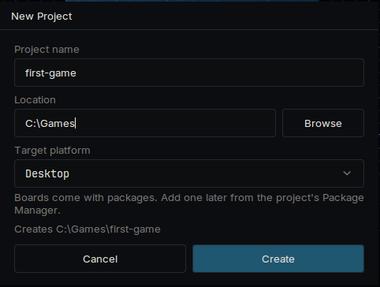
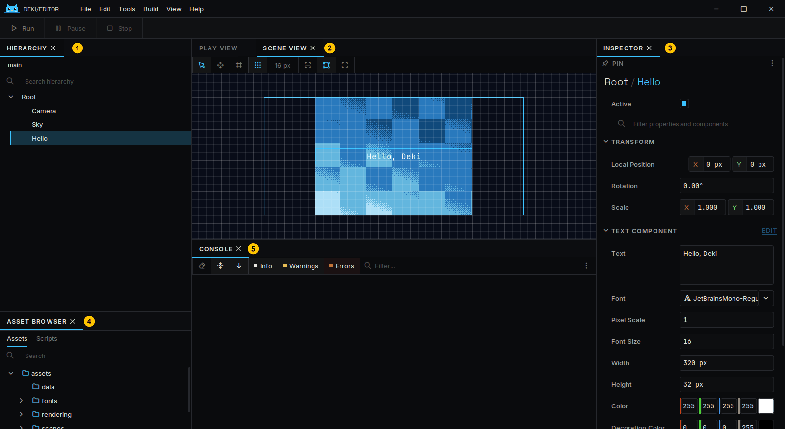
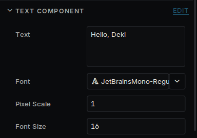
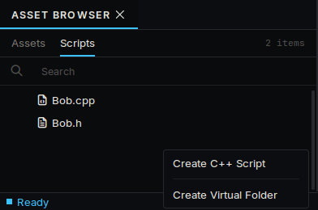
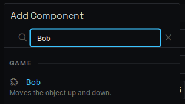
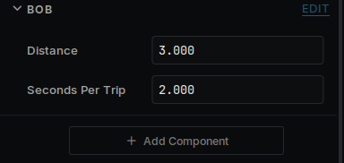
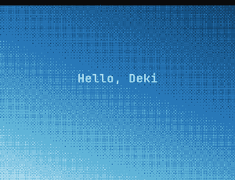
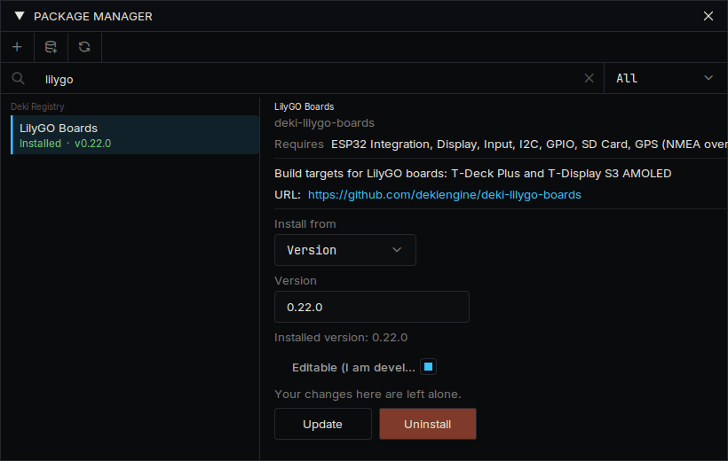
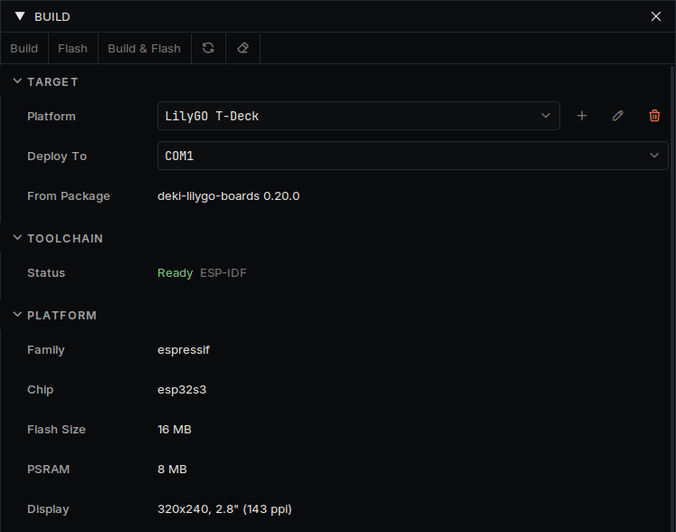

# Getting started

From downloading the editor to your own code running on a device.

## Install the editor

Download the archive for your computer from the
[latest release](https://github.com/dekiengine/deki-editor/releases/latest), unpack it anywhere and
run `DekiEditor`. The compiler is inside the archive, so there is nothing else to install.

## Create a project

Choose **File → New Project...**, give the project a name and a location, and leave the target
platform on Desktop. A device comes later, and the same project runs on both.



The first time a project opens, the editor downloads and builds its packages. This takes a few
minutes. Later opens take seconds.

The new project has one scene with three objects: a **Camera**, a gradient called **Sky** and a text
called **Hello**.

## Look around



| | Panel | What it is for |
| --- | --- | --- |
| 1 | **Hierarchy** | The objects in the scene |
| 2 | **Scene View** | Where they are; drag them here |
| 3 | **Inspector** | The components of the selected object and their values |
| 4 | **Asset Browser** | Your files, with a **Scripts** tab for your code |
| 5 | **Console** | Messages from the engine and your code |

An object is a position in the scene. What it does comes from its components, and everything you
see in the Inspector is a component.

## Change something



1. Select **Hello** in the Hierarchy.
2. In the Inspector, change **Text** to something else.
3. Press **Run** at the top left of the window, or Ctrl+P.
4. Press **Stop**, then save the scene with Ctrl+S.

Changes made while the game is playing are thrown away when it stops. The Inspector says so while
it is playing.

Distances are in meters. The camera shows 15 meters from top to bottom, whatever the size of the
screen: see [Units](units.md) and [Screens](screens.md).

## Write a component

In the Asset Browser, open **Scripts**, right-click and choose **Create C++ Script**. Name it `Bob`.
The editor creates `src/Bob.h` and `src/Bob.cpp`. Open them in any text editor and replace what is
there.



`src/Bob.h`:

```cpp
#pragma once

#include <deki/Engine.h>

DEKI_CATEGORY("Game")
DEKI_DESCRIPTION("Moves the object up and down.")
class Bob : public Deki::Component
{
public:
    // DEKI_EXPORT shows a field in the Inspector and saves it in the scene.
    DEKI_EXPORT
    float distance = 3.0f;

    DEKI_EXPORT
    float secondsPerTrip = 2.0f;

    void Start() override;
    void Update() override;

private:
    float m_StartY = 0.0f;
    float m_Elapsed = 0.0f;
};
```

`src/Bob.cpp`:

```cpp
#include "Bob.h"

#include <cmath>

void Bob::Start()
{
    m_StartY = GetOwner()->GetWorldY();
}

void Bob::Update()
{
    // The time since the last frame is in milliseconds.
    m_Elapsed += Deki::Time::GetDeltaTimeF() * 0.001f;
    const float y = m_StartY + std::sin(m_Elapsed * 6.2831853f / secondsPerTrip) * distance;
    GetOwner()->SetWorldPosition(GetOwner()->GetWorldX(), y);
}
```

Save both files and go back to the editor. It sees the change and rebuilds your code; the progress
is in the **Activity** panel, and compile errors are listed there.

Select **Hello**, press **Add Component** and pick **Bob**. Its two fields are in the Inspector. Press
**Run** and the text moves up and down. Change a field or the code while it runs and try again.







`Awake`, `Start` and `Update` are the calls a component can receive. It declares the ones it needs.

## Put it on a device

1. Open **View → Package Manager** and install your device's package. Every supported device has a
   page under **Devices** that names it.
2. Open **Build → Build Panel** and choose the device in the list of platforms. Its boot scene and
   settings are copied into your project's `platforms/` folder, and they are yours to change.
3. The panel's **Toolchain** section says whether the device's compiler is installed. If it says
   **Not installed**, open **Build → Platform Manager...**, go to **Toolchains** and install it. This
   is a large download, needed once.
4. Connect the device, choose it under **Deploy To**, and press **Build & Flash**, or **Build & Install**
   on a handheld that loads from an SD card.





The first build for a device takes several minutes. The scene you made runs on it unchanged. To add a
device Deki does not have yet, see [Use your own device](your-own-device.md).

## Where to go next

- [Project layout](project-layout.md): what is in the project folder
- [Your first game](first-game.md) and [Your first app](first-app.md): build something whole
- [Components](components.md): more about writing your own code
- [Sprites](sprites.md), [Text](text.md) and [Input](input.md): images, words and controls
- [UI widgets](ui-widgets.md): buttons, sliders, lists
- [Speed](performance.md): the tools that show where time and memory go
- The list of packages on the [front page](https://dekiengine.github.io/docs/) for sound, tilemaps,
  physics, radio and sensors
