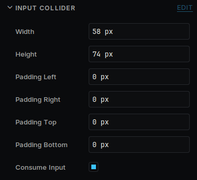

# Input

Keys, buttons and touch reach your code the same way on every device. Each device's page says what it has.

## Is a key held down?

Check it in `Update`. This suits movement.

```cpp
#include "DekiInput.h"
#include "Keys.h"

if (DekiInput::DekiInput::IsKeyPressed(DekiInput::Keys::Left))
{
    MoveLeft();
}
```

`Keys` has `Up`, `Down`, `Left`, `Right`, `Enter`, `Space`, `Esc` and the letters and numbers.

## Buttons and gamepads

A handheld's buttons and a desktop gamepad arrive as keys, the same keys on both, so a game made for one plays with the other.

| Button | Key |
| --- | --- |
| D-pad, left stick | `Up`, `Down`, `Left`, `Right` |
| A, Start | `Enter` |
| B | `Esc` |
| X | `Space` |
| Y | `Tab` |
| Select, Back | `Backspace` |
| L1, R1 (LB, RB) | `q`, `e` |
| L2, R2 (LT, RT) | `z`, `c` |

The Miyoo Mini's Menu button quits to the Miyoo's menu. A desktop build reads every connected gamepad, and the editor's Play view does too. **Enable Gamepad** on the **SDL3 Input Setup** turns it off.

## The T-Deck's keyboard and trackball

The keyboard reports each key as it is typed, so a key is down for one frame. To walk while a key is held, turn on **Report Held Keys** on the **I2C Keyboard** in a copy of the board's boot scene: a key is then down for as long as it is held. It needs the keyboard's firmware to have that mode, which LilyGO's current one has.

The trackball moves a pointer, so it works with everything a finger works with. Its **Mode** set to **Keys** makes it the arrow keys and Enter instead. In either mode, `TakeRoll` gives how far it rolled since you last asked:

```cpp
#include "Trackball.h"

if (DekiInput::Trackball* ball = DekiInput::Trackball::Find())
{
    int32_t x = 0, y = 0;
    ball->TakeRoll(x, y);  // steps, right and down positive
}
```

## Which input sent it?

Every event names its source in `event.source`:

| Source | What it is |
| --- | --- |
| `SDL3` | A desktop build's keyboard and mouse |
| `Gamepad` | A desktop build's gamepads |
| `Miyoo` | The Miyoo Mini's buttons |
| `I2CKeyboard` | The T-Deck's keyboard |
| `Trackball` | The T-Deck's trackball |
| `DekiDisplayTouch` | A touchscreen |
| `Injected`, `Injected pointer` | The editor's Play view: its keyboard, gamepads and mouse |

`DekiInput::DekiInput::GetInput("Miyoo")` is not null when the device has that source, which tells a game what to show before anything is pressed.

## Did a key just go down?

For a jump or a menu press, listen for the event, once, in `Start`. Stop listening when the component goes away.

```cpp
// In the class:
size_t m_KeyListener = 0;
~Player() override;
```

```cpp
void Player::Start()
{
    m_KeyListener = DekiInput::DekiInput::RegisterEventCallback(
        [this](const DekiInput::InputEvent& event)
        {
            if (event.type == DekiInput::InputEventType::KeyDown && event.key == DekiInput::Keys::Space)
            {
                Jump();
            }
        });
}

Player::~Player()
{
    DekiInput::DekiInput::UnregisterEventCallback(m_KeyListener);
}
```

To read typing, use `event.character`. It is `A` for shift and the A key, where `event.key` is the A key either way.

## Touch and mouse

A touch, a click and the T-Deck's trackball pointer all arrive as the Mouse events: `MouseButtonDown`, `MouseMove`, `MouseButtonUp`, with `event.x` and `event.y` in screen pixels.

For a button, use a **Button Component**: see [UI widgets](ui-widgets.md).

For anything else that can be pressed, add an **Input Collider** and set its size.



**Padding** makes a small control easier to hit without making it look bigger. **Consume Input** stops the press from reaching objects behind it.

```cpp
#include "InputCollider.h"

void Target::Start()
{
    auto* area = GetOwner()->GetComponent<DekiInput::InputCollider>();
    area->onPointerDown.push_back([](float x, float y)
    {
        // x and y are in meters, in the world.
    });
}
```

`onPointerUp`, `onPointerEnter`, `onPointerExit` and `onPointerMove` work the same way.
