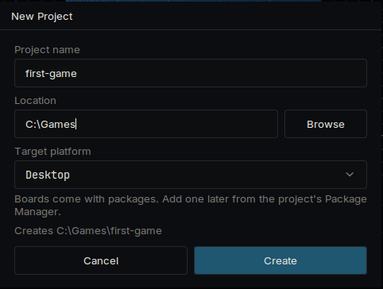
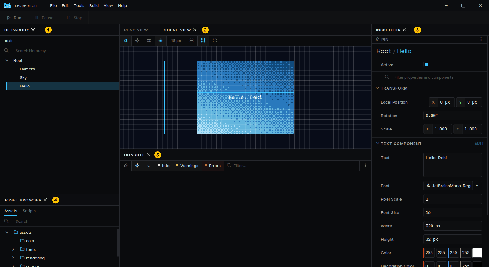
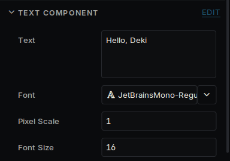
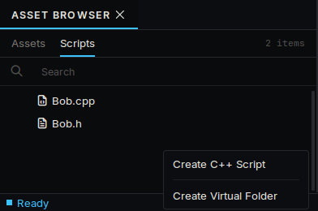
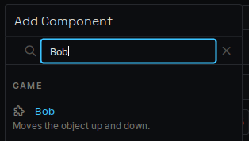
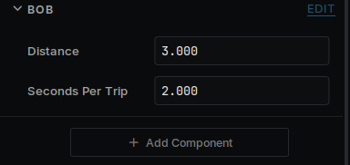
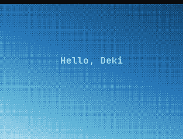
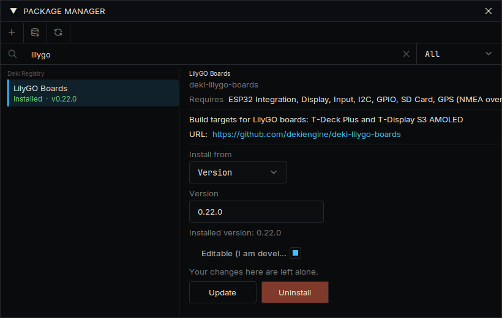
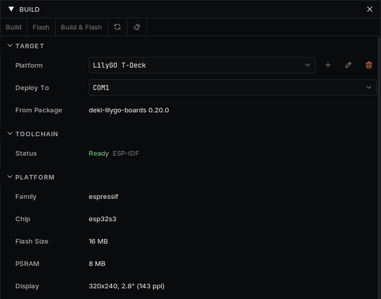

# はじめに

エディターのダウンロードから、自分のコードをデバイスで動かすまでの手順です。

## エディターをインストールする

[最新リリース](https://github.com/dekiengine/deki-editor/releases/latest) からお使いのコンピューター用のアーカイブをダウンロードし、好きな場所に展開して `DekiEditor` を実行します。コンパイラーはアーカイブに含まれているので、ほかにインストールするものはありません。

## プロジェクトを作る

**ファイル → 新規プロジェクト...** を選び、プロジェクトの名前と場所を指定します。ターゲットプラットフォームは Desktop のままにしてください。デバイスは後から追加でき、同じプロジェクトが両方で動きます。



プロジェクトを初めて開くと、エディターがパッケージをダウンロードしてビルドします。これには数分かかります。2 回目以降は数秒で開きます。

新しいプロジェクトには、3 つのオブジェクトを持つシーンが 1 つあります。**Camera**、グラデーションの **Sky**、テキストの **Hello** です。

## 画面を見てみる



| | パネル | 役割 |
| --- | --- | --- |
| 1 | **ヒエラルキー** | シーン内のオブジェクト |
| 2 | **シーンビュー** | オブジェクトの位置。ここでドラッグできます |
| 3 | **インスペクター** | 選択したオブジェクトのコンポーネントとその値 |
| 4 | **アセットブラウザー** | ファイルの一覧。コードは **スクリプト** タブにあります |
| 5 | **コンソール** | エンジンとコードからのメッセージ |

オブジェクトはシーン内の位置です。何をするかはコンポーネントで決まり、インスペクターに表示されるものはすべてコンポーネントです。

## 変更してみる



1. ヒエラルキーで **Hello** を選択します。
2. インスペクターで **テキスト** を別の文字に変更します。
3. ウィンドウ左上の **再生** を押すか、Ctrl+P を押します。
4. **停止** を押し、Ctrl+S でシーンを保存します。

ゲームの再生中に行った変更は、停止すると破棄されます。再生中はインスペクターにその旨が表示されます。

距離の単位はメートルです。カメラは、画面の大きさにかかわらず上から下まで 15 メートルを映します。[Units](units.md) と [Screens](screens.md) を参照してください。

## コンポーネントを書く

アセットブラウザーで **スクリプト** を開き、右クリックして **C++ スクリプトを作成** を選びます。名前は `Bob` にします。エディターが `src/Bob.h` と `src/Bob.cpp` を作成します。好きなテキストエディターで開き、中身を置き換えてください。



`src/Bob.h`:

```cpp
#pragma once

#include <deki/Engine.h>

DEKI_CATEGORY("Game")
DEKI_DESCRIPTION("Moves the object up and down.")
class Bob : public Deki::Component
{
public:
    // DEKI_EXPORT shows a field in the Inspector and saves it in the scene.
    DEKI_EXPORT
    float distance = 3.0f;

    DEKI_EXPORT
    float secondsPerTrip = 2.0f;

    void Start() override;
    void Update() override;

private:
    float m_StartY = 0.0f;
    float m_Elapsed = 0.0f;
};
```

`src/Bob.cpp`:

```cpp
#include "Bob.h"

#include <cmath>

void Bob::Start()
{
    m_StartY = GetOwner()->GetWorldY();
}

void Bob::Update()
{
    // The time since the last frame is in milliseconds.
    m_Elapsed += Deki::Time::GetDeltaTimeF() * 0.001f;
    const float y = m_StartY + std::sin(m_Elapsed * 6.2831853f / secondsPerTrip) * distance;
    GetOwner()->SetWorldPosition(GetOwner()->GetWorldX(), y);
}
```

両方のファイルを保存してエディターに戻ります。エディターが変更を検出してコードをビルドし直します。進行状況とコンパイルエラーは **アクティビティ** パネルに表示されます。

**Hello** を選択し、**コンポーネントを追加** を押して **Bob** を選びます。2 つのフィールドがインスペクターに表示されます。**再生** を押すとテキストが上下に動きます。フィールドやコードを変更して、もう一度試してみてください。







`Awake`、`Start`、`Update` はコンポーネントが受け取れる呼び出しです。必要なものだけを宣言します。

## デバイスで動かす

1. **表示 → パッケージマネージャー** を開き、お使いのデバイスのパッケージをインストールします。対応デバイスごとのページが **デバイス** にあり、パッケージ名を確認できます。
2. **ビルド → ビルドパネル** を開き、プラットフォームの一覧からデバイスを選びます。デバイスの起動シーンと設定がプロジェクトの `platforms/` フォルダーにコピーされ、自由に変更できます。
3. パネルの **ツールチェーン** の欄に、デバイス用のコンパイラーがインストールされているかどうかが表示されます。**未インストール** の場合は **ビルド → プラットフォームマネージャー...** を開き、**ツールチェーン** でインストールします。大きなダウンロードですが、必要なのは一度だけです。
4. デバイスを接続し、**デプロイ先** で選んで **ビルドして書き込み** を押します。SD カードから読み込む携帯機では **ビルドしてインストール** です。





デバイスの最初のビルドには数分かかります。作ったシーンは変更なしでデバイス上で動きます。Deki がまだ対応していないデバイスの場合は、[Platforms](platforms.md) に追加の方法があります。

## 次に読むもの

- [Project layout](project-layout.md): プロジェクトフォルダーの中身
- [Sprite System](sprite-system.md) と [Font System](font-system.md): 画像とテキスト
- [UI widgets](ui-widgets.md): ボタン、スライダー、リスト
- [Making it fast](performance.md) と [Memory](memory.md): デバイスの速度やメモリが足りないとき
- [トップページ](https://dekiengine.github.io/docs/) のパッケージ一覧: サウンド、タイルマップ、物理、無線、センサー
