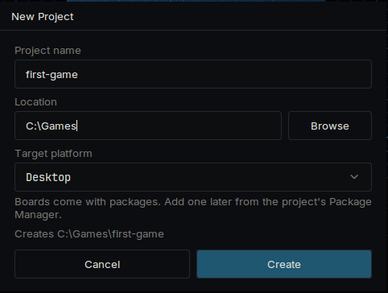
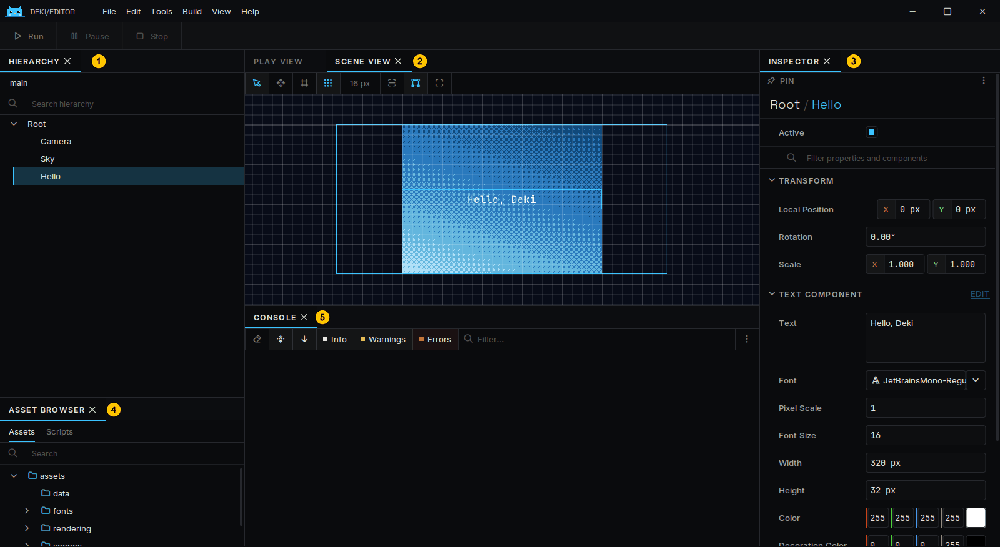
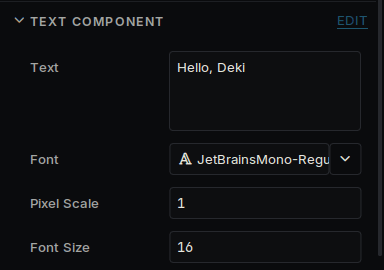
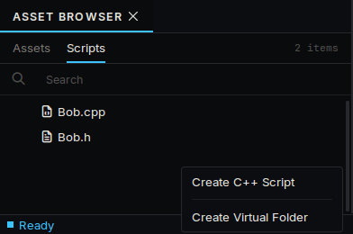
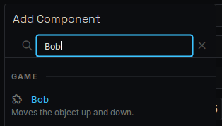
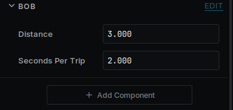
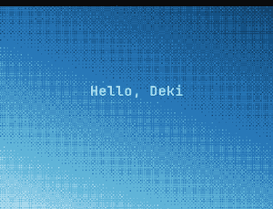
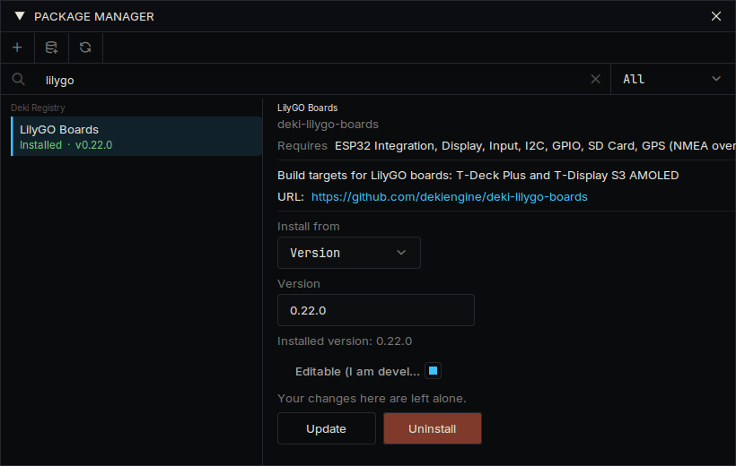
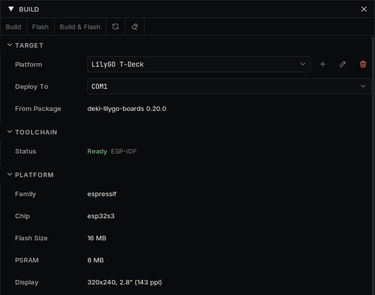

# 시작하기

에디터를 내려받는 것부터 내 코드를 디바이스에서 실행하는 것까지 안내합니다.

## 에디터 설치

[최신 릴리스](https://github.com/dekiengine/deki-editor/releases/latest)에서 사용하는 컴퓨터에 맞는 압축 파일을 내려받아 원하는 곳에 풀고 `DekiEditor`를 실행합니다. 컴파일러가 압축 파일에 들어 있으므로 따로 설치할 것은 없습니다.

## 프로젝트 만들기

**파일 → 새 프로젝트...** 를 선택하고 프로젝트 이름과 위치를 정합니다. 대상 플랫폼은 Desktop으로 둡니다. 디바이스는 나중에 추가할 수 있으며, 같은 프로젝트가 양쪽에서 실행됩니다.



프로젝트를 처음 열면 에디터가 패키지를 내려받아 빌드합니다. 몇 분 정도 걸립니다. 그다음부터는 몇 초면 열립니다.

새 프로젝트에는 오브젝트 세 개가 있는 씬이 하나 있습니다. **Camera**, 그라데이션 **Sky**, 텍스트 **Hello** 입니다.

## 둘러보기



| | 패널 | 용도 |
| --- | --- | --- |
| 1 | **하이어라키** | 씬에 있는 오브젝트 |
| 2 | **씬 뷰** | 오브젝트의 위치. 여기서 드래그할 수 있습니다 |
| 3 | **인스펙터** | 선택한 오브젝트의 컴포넌트와 그 값 |
| 4 | **에셋 브라우저** | 내 파일. 코드는 **스크립트** 탭에 있습니다 |
| 5 | **콘솔** | 엔진과 내 코드에서 나온 메시지 |

오브젝트는 씬 안의 한 위치입니다. 무엇을 하는지는 컴포넌트가 정하며, 인스펙터에 보이는 것은 모두 컴포넌트입니다.

## 바꿔 보기



1. 하이어라키에서 **Hello** 를 선택합니다.
2. 인스펙터에서 **텍스트** 를 다른 내용으로 바꿉니다.
3. 창 왼쪽 위의 **플레이** 를 누르거나 Ctrl+P를 누릅니다.
4. **정지** 를 누르고 Ctrl+S로 씬을 저장합니다.

게임이 실행되는 동안 바꾼 내용은 멈추면 사라집니다. 실행 중에는 인스펙터에 안내가 표시됩니다.

거리 단위는 미터입니다. 카메라는 화면 크기와 상관없이 위에서 아래까지 15미터를 보여 줍니다. [Units](units.md)와 [Screens](screens.md)를 참고하세요.

## 컴포넌트 작성하기

에셋 브라우저에서 **스크립트** 를 열고 마우스 오른쪽 버튼을 눌러 **C++ 스크립트 생성** 을 선택합니다. 이름은 `Bob`으로 합니다. 에디터가 `src/Bob.h`와 `src/Bob.cpp`를 만듭니다. 아무 텍스트 편집기로 열어 내용을 바꿉니다.



`src/Bob.h`:

```cpp
#pragma once

#include <deki/Engine.h>

DEKI_CATEGORY("Game")
DEKI_DESCRIPTION("Moves the object up and down.")
class Bob : public Deki::Component
{
public:
    // DEKI_EXPORT shows a field in the Inspector and saves it in the scene.
    DEKI_EXPORT
    float distance = 3.0f;

    DEKI_EXPORT
    float secondsPerTrip = 2.0f;

    void Start() override;
    void Update() override;

private:
    float m_StartY = 0.0f;
    float m_Elapsed = 0.0f;
};
```

`src/Bob.cpp`:

```cpp
#include "Bob.h"

#include <cmath>

void Bob::Start()
{
    m_StartY = GetOwner()->GetWorldY();
}

void Bob::Update()
{
    // The time since the last frame is in milliseconds.
    m_Elapsed += Deki::Time::GetDeltaTimeF() * 0.001f;
    const float y = m_StartY + std::sin(m_Elapsed * 6.2831853f / secondsPerTrip) * distance;
    GetOwner()->SetWorldPosition(GetOwner()->GetWorldX(), y);
}
```

두 파일을 저장하고 에디터로 돌아옵니다. 에디터가 변경을 감지해 코드를 다시 빌드합니다. 진행 상황과 컴파일 오류는 **활동** 패널에 표시됩니다.

**Hello** 를 선택하고 **컴포넌트 추가** 를 눌러 **Bob** 을 고릅니다. 필드 두 개가 인스펙터에 나타납니다. **플레이** 를 누르면 텍스트가 위아래로 움직입니다. 필드나 코드를 바꿔서 다시 해 보세요.







`Awake`, `Start`, `Update`는 컴포넌트가 받을 수 있는 호출입니다. 필요한 것만 선언합니다.

## 디바이스에서 실행하기

1. **보기 → 패키지 관리자** 를 열고 디바이스 패키지를 설치합니다. **디바이스** 에 지원 디바이스별 페이지가 있으며 패키지 이름이 나와 있습니다.
2. **빌드 → 빌드 패널** 을 열고 플랫폼 목록에서 디바이스를 선택합니다. 디바이스의 부트 씬과 설정이 프로젝트의 `platforms/` 폴더로 복사되며, 자유롭게 바꿀 수 있습니다.
3. 패널의 **툴체인** 항목에 디바이스용 컴파일러가 설치되어 있는지 표시됩니다. **설치되지 않음** 이라면 **빌드 → 플랫폼 관리자...** 를 열고 **툴체인** 에서 설치합니다. 용량이 크지만 한 번만 받으면 됩니다.
4. 디바이스를 연결하고 **배포 대상** 에서 고른 뒤 **빌드 후 플래시** 를 누릅니다. SD 카드에서 불러오는 휴대기는 **빌드 후 설치** 입니다.





디바이스의 첫 빌드는 몇 분 걸립니다. 만든 씬은 수정 없이 디바이스에서 실행됩니다. Deki가 아직 지원하지 않는 디바이스라면 [Platforms](platforms.md)를 참고하세요.

## 다음 단계

- [Project layout](project-layout.md): 프로젝트 폴더의 구성
- [Sprite System](sprite-system.md)과 [Font System](font-system.md): 이미지와 텍스트
- [UI widgets](ui-widgets.md): 버튼, 슬라이더, 목록
- [Making it fast](performance.md)와 [Memory](memory.md): 디바이스의 속도나 메모리가 부족할 때
- [첫 페이지](https://dekiengine.github.io/docs/)의 패키지 목록: 사운드, 타일맵, 물리, 무선, 센서
