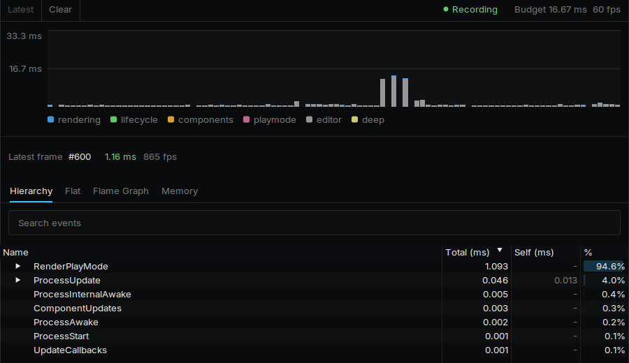
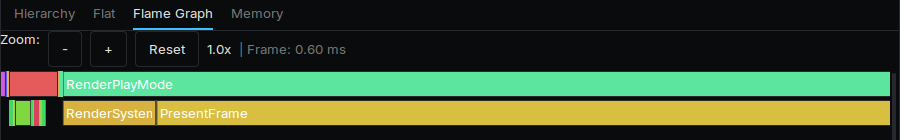
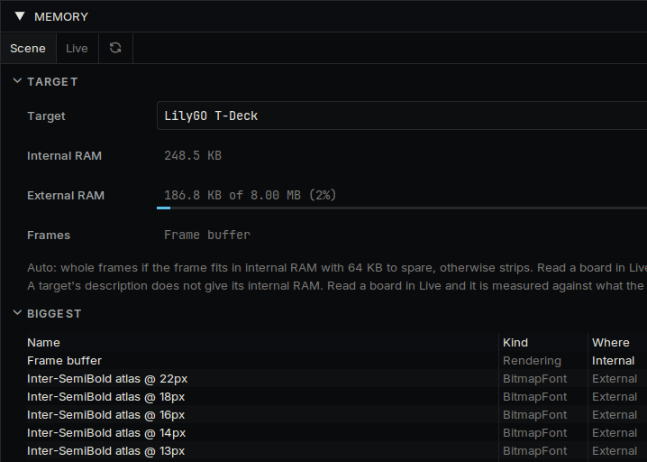

# Speed

The tools that show where a frame's time and a device's memory go.

## What a frame is made of

| Part | What it covers |
| --- | --- |
| **Update** | Your components, and a scene that has just opened |
| **Render** | Drawing. In strips it also covers sending, since each strip is sent as soon as it is drawn |
| **Present** | Handing the frame to the display |

Every tool below reports in these terms.

## Profiler

**View → Profiler** records every frame in Play mode.



Each bar is a frame, split by colour into rendering, lifecycle, components, Play mode and the editor. The line marks the budget for your target frame rate. Click a bar to inspect that frame.

| View | What it shows |
| --- | --- |
| **Hierarchy** | Every event in the frame, nested as it ran, with total time, self time and share of the frame |
| **Flat** | The same events as one list, to sort by what costs most |
| **Flame Graph** | The frame as a timeline, to see what ran inside what |
| **Memory** | What was allocated, and from where |



The Profiler measures your computer. It shows what runs and in what proportion. For what a frame costs on a device, ask the device.

## On a device

Open **View → Serial Monitor**, connect, and send one of these lines. ESP32 devices answer all of them.

### DEKI:STATS

Averages over the last second:

```
DEKI:STATS fps=60.0 frameMs=16.66 updateMs=1.00 renderMs=7.80 presentMs=3.36 frames=60 internalFree=50807 externalFree=7340032 frameMode=whole bandRows=0
```

| Field | Meaning |
| --- | --- |
| `frameMs` | From one update to the next |
| `updateMs`, `renderMs`, `presentMs` | The three parts of a frame |
| `internalFree`, `externalFree` | RAM left, in bytes |
| `frameMode`, `bandRows` | Whole frames or strips, and how tall a strip is |

A `presentMs` that takes up the rest of the frame means frames are waiting on the display. A rate held at the panel's refresh, near 60, is a frame waiting for that refresh.

### DEKI:PROFILE

The first request turns the render profiler on. Each one after reports what it measured since the last, per frame, one line per component type:

```
DEKI:PROFILE:ITEM Sprite Component draws=42.0 contentUs=310 blitUs=2840 pixels=38400
DEKI:PROFILE:PATH CopyRows blits=30.0 pixels=30000 us=1200 nsPerPixel=40.0
```

| Field | Meaning |
| --- | --- |
| `draws` | How many it drew |
| `contentUs` | Preparing what to draw, such as a tiled image or a text |
| `blitUs` | Putting the pixels in the frame |
| `pixels` | How many pixels it touched |
| `nsPerPixel` | What each pixel costs on that drawing path |

Then one line per object in the scene, most expensive first, and how many objects there were:

```
DEKI:PROFILE:OBJECT "Root/Camera/Counter Side" type=ShapeComponent order=1989 measureUs=57.1 contentUs=0.0 blitUs=156.7 pixels=2672 draws=1.30 new=0.00 changed=0.00 still=0.92 overPin=0.00
DEKI:PROFILE:OBJECTS shown=64 of=118
```

| Field | Meaning |
| --- | --- |
| `measureUs` | Its share of finding what changed (with **Redraw Changes** on) |
| `contentUs` | Preparing what it draws while drawing; for a render pass, the whole pass on that object |
| `blitUs`, `pixels` | Putting its pixels in the frame |
| `draws` | How many times it was drawn: once for each part of the frame redrawn over it |
| `new` | Drawn for the first time, or back on screen |
| `changed` | Drawn differently, or somewhere else |
| `still` | The same on screen while the world scrolled under it |
| `overPin` | Drawn where something kept on screen sits |

A device sends its 64 most expensive objects.

Send `DEKI:PROFILE:OFF` when you are done. The profiler stays on, timing every draw, until then or until the device restarts.

### DEKI:MEMORY

Internal and external RAM in use, the peaks, the free space and the lowest it has been since boot, followed by every place that allocated, with bytes and blocks.

## Render Profiler

**Tools → Rendering → Render Profiler** shows the same rows per object as a table: for the Play view, refreshed every second, or for a device on a serial port, measured for 3 seconds. Sort by any column; filter by object or type.

## Memory panel

**View → Memory** shows the same figures without the serial lines.



- **Scene** works out what the open scene takes on a target without running it: the frame buffer or strip, each asset at the size and format it has on that target, and each object.
- **Live** measures a running game, either Play mode or a device on its serial port, and groups what it finds by category.

For how the engine allocates, see [Memory](memory.md).

## Frame Capture

**View → Frame Capture** saves Play mode frames as a PNG sequence, for checking the real frame rate and looking at frames one by one.

## From a script or an AI agent

The editor's MCP tools return the same data as JSON.

| Tool | What it returns |
| --- | --- |
| `device_stats` | `DEKI:STATS` |
| `device_profile` | `DEKI:PROFILE`, measured for a few seconds: stages, component types, drawing paths and objects |
| `device_memory` | `DEKI:MEMORY`, grouped into categories |
| `memory_report` | The Memory panel's **Scene** or Play mode figures |
| `device_screenshot` | The frame a device is showing, as a PNG |
| `frame_timing` | Where the editor's own frame time goes |

## What the engine decides at boot

The boot log has one line for each, saying what was chosen and why.

| What | How it is chosen |
| --- | --- |
| Whole frames or strips | Whole frames when the framebuffer fits in internal RAM with room to spare, strips when it does not. Strips are drawn into internal RAM a few rows or columns at a time, which is much faster than drawing a whole frame in PSRAM. (`frameMode`) |
| Sending from the other core | On a dual-core chip with the memory for two frame copies, each frame is sent while the next is drawn. Otherwise frames are sent as they are drawn. The sender runs on the core the game does not, at priority 5. (`asyncPresent`) |
| Tearing | With a TE line wired (`tePin`), frames follow the panel's refresh signal. Without one, the panel's scanline is read back instead (`scanlineSync`). A panel that cannot be read back is sent as drawn, and can tear. |

## Settings

In **Project Settings → Rendering**.

| Setting | What it does |
| --- | --- |
| `redrawChanges` | Each frame draws and sends only what changed. A frame where most of the screen changes is drawn whole as usual. A camera that moves by whole pixels and sits on whole pixels moves the last frame instead, and only the edge it uncovers is drawn. What stays on screen as it moves, such as a HUD panel under the camera, keeps the pixels of its opaque middle. A camera between pixels, a 2D light or frames drawn in strips draw whole frames while it moves |
| `bandRows` | The size of a strip. Bigger strips walk the scene fewer times and take more internal RAM |
| `frameMode` | **Auto**, **Whole Frames** or **Strips** |
| `asyncPresent` | Sends frames from the other core |
| `usePsram`, `doubleBuffer` | Where whole frames are drawn |
| `spiReadHz` | The clock for reading the panel back |
