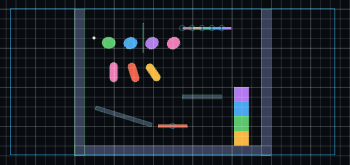
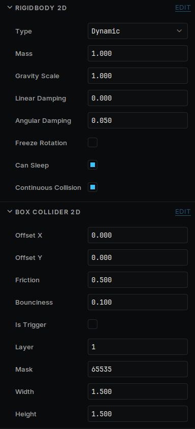

# Physics

Things that fall, bounce and collide. Install **deki-physics-2d** from the Package Manager first.

## Make something fall

1. Make an object for the ground and add a **Box Collider 2D**.
2. Make another object above it and add a **Rigidbody 2D** and a **Box Collider 2D**.
3. Press **Run**.

Colliders are drawn in the Scene View. Select an object to drag the handles on its collider.



Positions are in meters and up is positive.

## Bodies

| **Type** | Moved by |
| --- | --- |
| **Dynamic** | Physics: gravity, forces and collisions |
| **Kinematic** | Your code, through its velocity. It pushes dynamic bodies and is not pushed |
| **Static** | Nothing |

An object with a collider and no **Rigidbody 2D** is a wall: it stays where it is unless you move it.



Turn on **Freeze Rotation** to keep a player upright.

## Colliders

Use **Box**, **Circle**, **Capsule** or **Polygon Collider 2D**. A capsule slides over small steps, which suits characters. A polygon has up to 8 corners and is always convex.

**Friction** is how much it grips and **Bounciness** how much it bounces.

**Layer** and **Mask** decide who touches whom. Each is a set of bits, and two colliders touch only if each one's **Mask** includes the other's **Layer**.

## Triggers

Turn on **Is Trigger** for an area that notices things without blocking them, such as a pickup or a goal.

## From code

```cpp
#include "Physics2DComponents.h"

using namespace DekiPhysics2D;

auto* body = GetOwner()->GetComponent<Rigidbody2D>();
body->AddImpulse({ 0.0f, 5.0f });

body->onCollisionBegin = [](Deki::Object* other) { /* hit something */ };
body->onTriggerBegin = [](Deki::Object* other) { /* entered a trigger */ };
```

It is safe to destroy an object from inside these.

To ask what is along a line:

```cpp
RayHit hit;
Deki::Object* what = nullptr;
if (Raycast({ 0.0f, 0.0f }, { 0.0f, 10.0f }, hit, &what))
{
    // hit.point, hit.normal and what
}
```

## Joints

**Hinge Joint 2D** pins a body at one point, free to turn: doors, chains and wheels. **Distance Joint 2D** keeps two points a set distance apart. With **Rope** on, they can come closer but not move further apart. Add either to an object that has a **Rigidbody 2D**.

## Good to know

- A **Physics 2D Settings** component, anywhere in the scene, sets gravity and how many steps run per second. Fewer steps cost less on a device.
- A body that has come to rest costs nothing until something touches it. Leave **Can Sleep** on.
- To place a body somewhere, moving its object works, but it lands on top of whatever is there and gets pushed out.
