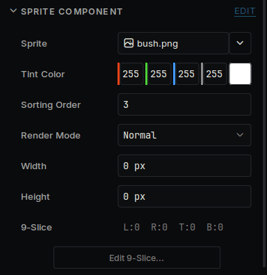
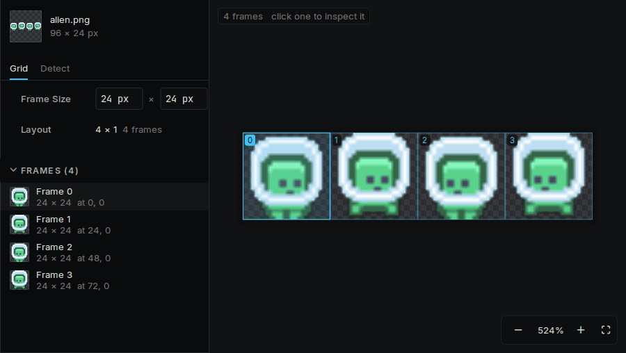
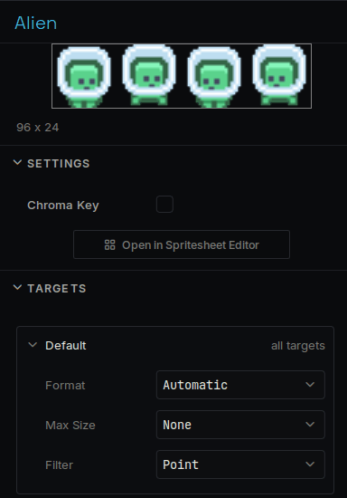

# Sprites

How to get an image into your game and on the screen.

## Add an image

Drag a PNG from your computer onto the Asset Browser, or copy it into the project's `assets` folder. The editor imports it on its own.

## Show it

1. Select an object, or make a new one.
2. Press **Add Component** and pick **Sprite Component**.
3. In **Sprite**, choose your image.



| Field | What it does |
| --- | --- |
| **Tint Color** | Multiplied into every pixel. White leaves the image alone. |
| **Sorting Order** | Higher numbers draw on top. |
| **Render Mode** | **Normal** draws it once. **Tiled** repeats it to fill **Width** and **Height**. **Nine Slice** stretches the middle and keeps the corners, for panels and buttons. |

For **Nine Slice**, press **Edit 9-Slice...** and drag the four guides to mark the corners.

## Cut a sheet into frames

When one image holds many sprites:

1. Select the image in the Asset Browser.
2. In the Inspector, press **Open in Sprite Slicer**.
3. Under **Grid**, set the size of one frame. If the sprites are different sizes, use **Detect**, which finds them by the transparent space around them.
4. Press **Save**.



Each frame can now be chosen in a **Sprite** field. To make them move, see [Animation](animation.md).

## How an image is stored

Select the image in the Asset Browser. Its settings are in the Inspector.



| Setting | What it does |
| --- | --- |
| **Format** | How the pixels are stored. **Automatic** picks the smallest format the screen can show. |
| **Max Size** | Shrinks a big image to save memory. |
| **Filter** | **Point** keeps pixel art sharp. |

**Default** applies everywhere. Open a device under it to give that device its own values, such as a smaller **Max Size** on a device with little memory.

## From code

```cpp
#include "SpriteComponent.h"

auto* sprite = GetOwner()->GetComponent<Deki2D::SpriteComponent>();
sprite->SetTint(255, 80, 80);
sprite->flipHorizontal = true;
```

To swap the image, point a field at the other one in the Inspector:

```cpp
DEKI_EXPORT
Deki::AssetRef<Deki2D::Sprite> hurtSprite;
```

```cpp
sprite->sprite = hurtSprite.Get();
```
