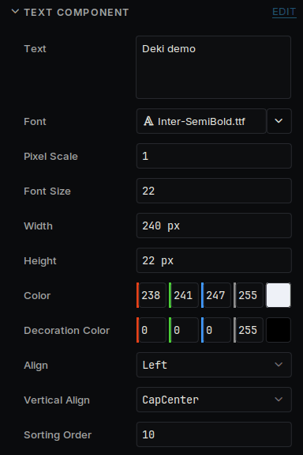
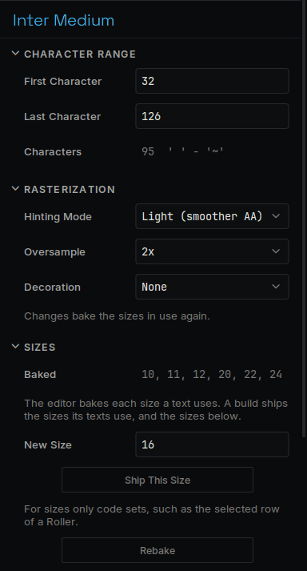

# Text

How to show text and use your own fonts.

## Show text

Add a **Text Component** to an object and type in **Text**.



| Field | What it does |
| --- | --- |
| **Font** | The font file to use |
| **Font Size** | The size, in pixels |
| **Width**, **Height** | The box the text sits in. Lines wrap between words to fit the width |
| **Align**, **Vertical Align** | Where the text sits inside the box |
| **Pixel Scale** | Draws each pixel of the font as a larger block, which keeps a pixel font sharp |

## Use your own font

Drag a `.ttf` or `.bdf` file onto the Asset Browser, then choose it in **Font**. The editor prepares each size the first time a text uses it.

Select the font in the Asset Browser to see its settings.



| Setting | What it does |
| --- | --- |
| **First Character**, **Last Character** | Which characters are included. The default is plain English. Accented letters and other alphabets need a wider range |
| **Decoration** | Adds an outline or a shadow. Its colour is the text's **Decoration Color** |
| **Ship This Size** | Includes a size that only your code sets |

Each size takes memory on a device, so a few sizes go a long way.

## From code

```cpp
#include "TextComponent.h"

auto* text = GetOwner()->GetComponent<Deki2D::TextComponent>();
text->SetText("Game over");
text->SetColor(255, 200, 0);
```

To translate your game, see [Languages](localization.md).
