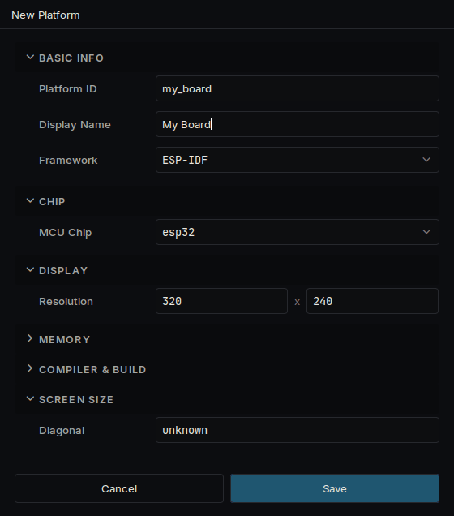
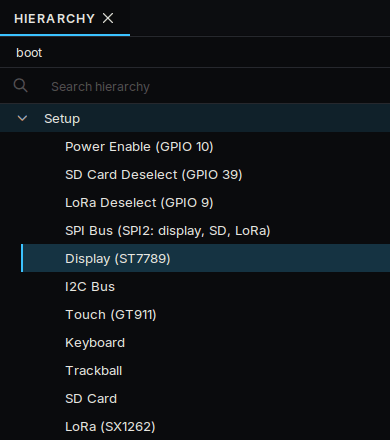
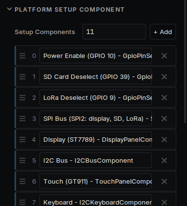
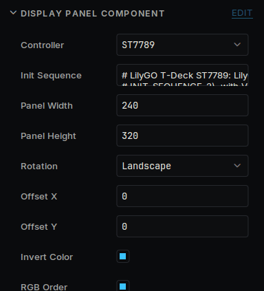

# Use your own device

Deki is modular and can run on almost any target with enough RAM. Your device does not have to be on the list: hardware support is a package like everything else, so you add what your device needs.

## What you need

How you add a device depends on what it is.

| Your device | How to add it |
| --- | --- |
| An Espressif chip | The rest of this page |
| Anything else, such as a Linux handheld | A package with its own build backend, display and input, as `deki-miyoo-boards` has. Start from [Platforms](platforms.md) |

For an Espressif device you need:

- **A chip ESP-IDF supports.** The list offers them all. An ESP32-S3 with PSRAM is the safe choice: it is what every Espressif device on the list uses.
- **A screen and touch controller Deki knows.** See the table below.
- **The device's pinout**, from its schematic or its maker's example code.

| Part | Runs on a real device | Written and tested, not yet tried on a device |
| --- | --- | --- |
| Screen | ST7789, RM67162 | ST7789P3, ILI9341, ST7796, ILI9488, ST7735, ST7735S, GC9A01, SSD1351, CO5300 |
| Touch | GT911, CST816S, CST816T | FT5x06, FT6x06, XPT2046 |

## Copy the closest device

Starting from a device like yours saves most of the work. Install the package that has it, then copy it under a new name:

```bash
DekiEditor --tool create_platform --args '{"id":"my_device","from":"lilygo_t_deck","display_name":"My Device"}' <project>
```

The copy is yours, in your project's `platforms/my_device/` folder.

To start with nothing instead, press **+** beside the platform list in the Build panel and pick **ESP-IDF**.

Open the platform with the pencil in the Build panel and set what is different: the chip, the resolution, the screen's diagonal, and the flash and PSRAM under **Memory**.



## Say how it is wired

Open **Build → Platform Manager...**, choose your device and press **Open Boot Scene**. This scene runs when the device starts, and it never reaches the screen: each object under **Setup** is one step that brings a piece of hardware up.



The steps run in the order of **Setup Components**, on the **Setup** object. The screen's bus has to come before the screen. For a part your device does not have, remove its line there and delete its object.



Select each step and set its pins in the Inspector.

| Step | What to set |
| --- | --- |
| Power pin | The pin that powers the screen, if your device has one |
| SPI bus | The bus and its clock and data pins |
| Display | Controller, Panel Width and Height, Rotation, and the pins |
| I2C bus | SDA and SCL |
| Touch | Controller and interrupt pin |

Panel Width and Height are the panel's own, before rotation: a 320 x 240 screen shown sideways is 240 wide and 320 high, with Rotation on Landscape.



## Build it

Choose your device in the Build panel and press **Build & Flash**. **View → Serial Monitor** shows the boot log, which says what started and what did not.

## If the screen looks wrong

| What you see | What to change |
| --- | --- |
| Nothing at all | The power pin and the backlight pin. Some backlights are on when their pin is low |
| Noise, or a white screen | The Controller and the pins. Try a lower SPI clock |
| Colours like a negative | Invert Color |
| Red and blue swapped | RGB Order |
| Dark colours pink, white green | Swap Bytes |
| Picture shifted, with a strip of noise | Offset X and Offset Y |
| Sideways or upside down | Rotation |
| Washed out, or a ghost of the last image | Init Sequence, from the panel maker's own start-up code |

## Make it fast

Most of it [is chosen for you](performance.md). These describe the wiring, which the device cannot find out by itself.

| Setting | Set it to |
| --- | --- |
| SPI clock (`spiWriteHz`) | The fastest the panel takes. Most ST7789 modules take 80 MHz; on a parallel bus, 20 MHz is safe |
| TE pin (`tePin`) | The GPIO the panel's TE output is wired to, if it is. The best way to stop tearing |
| `readsOnMosi` | On when the panel answers on its data line instead of MISO. Only matters without a TE pin |

## Share it

Once it runs, you can put the device in a package so others can pick it from the list: [Platforms](platforms.md) says how.
