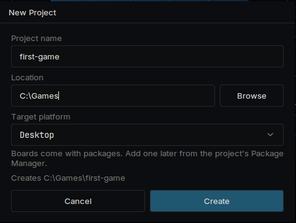
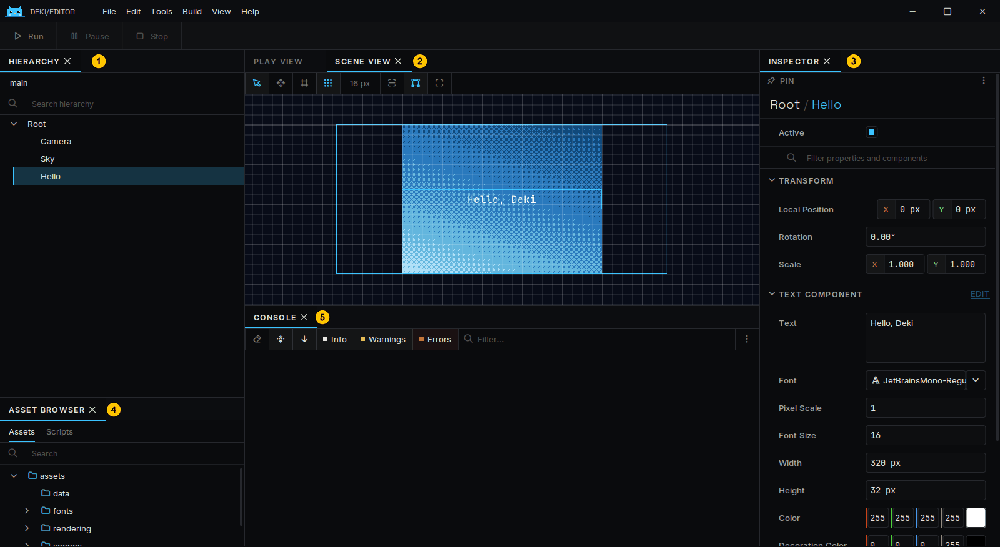
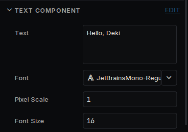
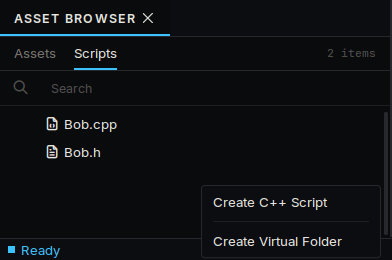
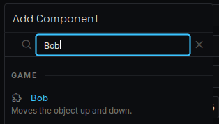
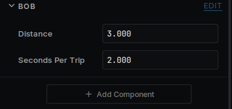
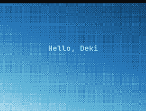
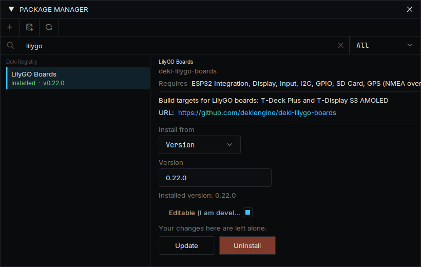
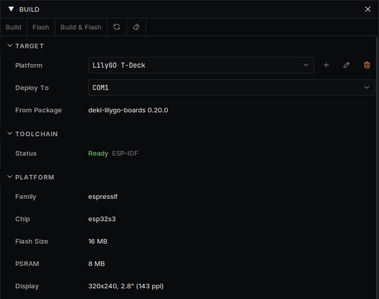

# 快速入门

从下载编辑器到让你自己的代码在设备上运行。

## 安装编辑器

从[最新版本](https://github.com/dekiengine/deki-editor/releases/latest)下载适合你电脑的压缩包,解压到任意位置,然后运行 `DekiEditor`。压缩包里已经包含编译器,不需要再安装其他东西。

## 创建项目

选择 **文件 → 新建项目...**,填写项目名称和位置,目标平台保持 Desktop。设备可以以后再加,同一个项目在两者上都能运行。



第一次打开项目时,编辑器会下载并构建它的包,这需要几分钟。之后打开只需几秒。

新项目有一个场景,里面有三个对象:**Camera**、名为 **Sky** 的渐变和名为 **Hello** 的文本。

## 认识界面



| | 面板 | 用途 |
| --- | --- | --- |
| 1 | **层级** | 场景中的对象 |
| 2 | **场景视图** | 对象的位置,可以在这里拖动 |
| 3 | **检视器** | 所选对象的组件及其数值 |
| 4 | **资源浏览器** | 你的文件,代码在 **脚本** 标签页中 |
| 5 | **控制台** | 来自引擎和你的代码的消息 |

对象是场景中的一个位置。它做什么由组件决定,检视器中显示的都是组件。

## 改点东西



1. 在层级中选择 **Hello**。
2. 在检视器中把 **文本** 改成别的内容。
3. 按窗口左上角的 **运行**,或按 Ctrl+P。
4. 按 **停止**,然后用 Ctrl+S 保存场景。

游戏运行时所做的更改在停止后会被丢弃。运行期间检视器会给出提示。

距离的单位是米。无论屏幕多大,摄像机从上到下都显示 15 米。请参阅 [Units](units.md) 和 [Screens](screens.md)。

## 编写组件

在资源浏览器中打开 **脚本**,右键选择 **创建 C++ 脚本**,命名为 `Bob`。编辑器会创建 `src/Bob.h` 和 `src/Bob.cpp`。用任意文本编辑器打开它们,并替换其中的内容。



`src/Bob.h`:

```cpp
#pragma once

#include <deki/Engine.h>

DEKI_CATEGORY("Game")
DEKI_DESCRIPTION("Moves the object up and down.")
class Bob : public Deki::Component
{
public:
    // DEKI_EXPORT shows a field in the Inspector and saves it in the scene.
    DEKI_EXPORT
    float distance = 3.0f;

    DEKI_EXPORT
    float secondsPerTrip = 2.0f;

    void Start() override;
    void Update() override;

private:
    float m_StartY = 0.0f;
    float m_Elapsed = 0.0f;
};
```

`src/Bob.cpp`:

```cpp
#include "Bob.h"

#include <cmath>

void Bob::Start()
{
    m_StartY = GetOwner()->GetWorldY();
}

void Bob::Update()
{
    // The time since the last frame is in milliseconds.
    m_Elapsed += Deki::Time::GetDeltaTimeF() * 0.001f;
    const float y = m_StartY + std::sin(m_Elapsed * 6.2831853f / secondsPerTrip) * distance;
    GetOwner()->SetWorldPosition(GetOwner()->GetWorldX(), y);
}
```

保存两个文件并回到编辑器。编辑器会发现更改并重新构建你的代码,进度和编译错误显示在 **活动** 面板中。

选择 **Hello**,按 **添加组件** 并选择 **Bob**。它的两个字段会显示在检视器中。按 **运行**,文本就会上下移动。改一改字段或代码,再试一次。







`Awake`、`Start` 和 `Update` 是组件可以接收的调用,只需声明你用到的。

## 放到设备上

1. 打开 **视图 → 包管理器**,安装你的设备的包。**设备** 下每块受支持的设备都有自己的页面,上面写明了包名。
2. 打开 **构建 → 构建面板**,在平台列表中选择设备。它的启动场景和设置会复制到项目的 `platforms/` 文件夹中,你可以随意修改。
3. 面板的 **工具链** 部分会显示设备的编译器是否已安装。如果显示 **未安装**,打开 **构建 → 平台管理器...**,在 **工具链** 中安装。下载量较大,只需一次。
4. 连接设备,在 **部署到** 中选择它,然后按 **构建并烧录**;从 SD 卡加载的掌机则按 **构建并安装**。





设备的第一次构建需要几分钟。你做的场景无需修改即可运行。如果是 Deki 尚未支持的设备,请参阅 [Platforms](platforms.md)。

## 接下来

- [Project layout](project-layout.md):项目文件夹里有什么
- [Sprite System](sprite-system.md) 和 [Font System](font-system.md):图像和文本
- [UI widgets](ui-widgets.md):按钮、滑块、列表
- [Making it fast](performance.md) 和 [Memory](memory.md):设备速度或内存不够时
- [首页](https://dekiengine.github.io/docs/)的包列表:声音、瓦片地图、物理、无线电和传感器
